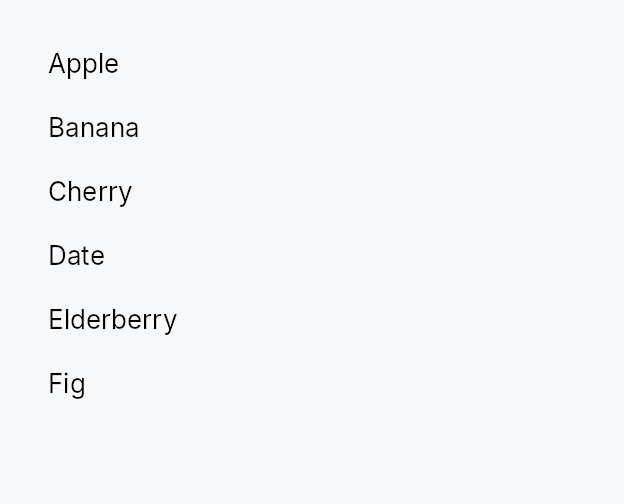
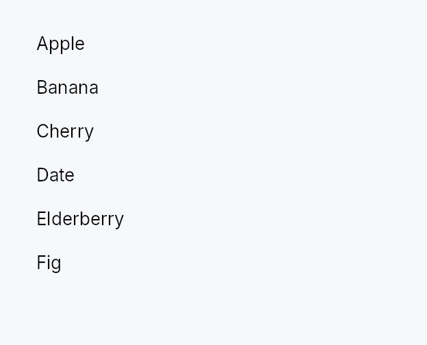

<!-- SPDX-License-Identifier: MPL-2.0 -->
<!-- SPDX-FileCopyrightText: 2026 FernTech -->

# ListView



ListView — a virtualized, scrollable list backed by a reactive data model.

## Public types

| Kind | Name |
| ---: | :--- |
| `struct` | [`ListView`](#listview) — A virtualized scrollable list backed by a `ListModel<T>` or `ListDataSource` |
| `struct` | [`ListViewHandle`](#listviewhandle) — A handle on a mounted `ListView`, to scroll it to an item from outside the widget — a view-model reacting to a search hit, a "jump to" command |

## Public functions

### `ListView`

| Returns | Function |
| ---: | :--- |
| | **Constructors** |
| `Self` | [`new(model: ListModel<T>, delegate: impl Fn(usize, &T, bool) -> Box<dyn Widget> + 'static)`](#listview-new) |
| `Self` | [`from_source<S: teksilo_data::ListDataSource<Item = T>>(source: S, delegate: impl Fn(usize, &T, bool) -> Box<dyn Widget> + 'static)`](#listview-from_source) |
| `Self` | [`from_source_keyed<S: teksilo_data::ListDataSource<Item = T>>(source: S, keyed: KeyedSelectionModel<S::Key>, delegate: impl Fn(usize, &T, bool) -> Box<dyn Widget> + 'static)`](#listview-from_source_keyed) |
| | **Builder methods** |
| `Self` | [`enabled(enabled: impl Into<Prop<bool>>)`](#listview-enabled) |
| `Self` | [`overscroll_behavior(behavior: OverscrollBehavior)`](#listview-overscroll_behavior) |
| `Self` | [`smooth_scrolling(enabled: bool)`](#listview-smooth_scrolling) |
| `Self` | [`smooth_scroll_duration(duration: Duration)`](#listview-smooth_scroll_duration) |
| `Self` | [`scroll_bar_style(style: ScrollBarMode)`](#listview-scroll_bar_style) |
| `Self` | [`item_height(height: f32)`](#listview-item_height) |
| `Self` | [`item_height_fn(f: impl Fn(usize) -> f32 + 'static)`](#listview-item_height_fn) |
| `Self` | [`auto_item_height(estimated: f32)`](#listview-auto_item_height) |
| `Self` | [`spacing(spacing: f32)`](#listview-spacing) |
| `Self` | [`sections<P: SectionProvider>(provider: P)`](#listview-sections) |
| `Self` | [`section_header_delegate(f: impl Fn(usize, &str) -> Box<dyn Widget> + 'static)`](#listview-section_header_delegate) |
| `Self` | [`section_header_height(height: f32)`](#listview-section_header_height) |
| `Self` | [`pinned_section_headers(enabled: bool)`](#listview-pinned_section_headers) |
| `Self` | [`selection(sel: SelectionModel)`](#listview-selection) |
| `Self` | [`reorderable(enabled: bool)`](#listview-reorderable) |
| `Self` | [`exportable(mode: DragTransferMode)`](#listview-exportable) |
| `Self` | [`export_external(f: impl Fn(&[T]) -> Vec<(String, Vec<u8>)> + 'static)`](#listview-export_external) |
| `Self` | [`on_rows_transferred_out(f: impl Fn(&[usize], &mut teksilo_core::widget::EventContext) + 'static)`](#listview-on_rows_transferred_out) |
| `Self` | [`accept_foreign_rows(accept: bool)`](#listview-accept_foreign_rows) |
| `Self` | [`on_rows_received(f: impl Fn(Vec<T>, usize, &mut teksilo_core::widget::EventContext) + 'static)`](#listview-on_rows_received) |
| `Self` | [`on_activate(f: impl Fn(usize, &mut teksilo_core::widget::EventContext) + 'static)`](#listview-on_activate) |
| `Self` | [`activate_on(mode: crate::data_views::ActivateOn)`](#listview-activate_on) |
| `Self` | [`row_tooltip_sticky(on: bool)`](#listview-row_tooltip_sticky) |
| `Self` | [`row_tooltip(f: impl Fn(usize, &T) -> Option<teksilo_i18n::LocalizedString> + 'static)`](#listview-row_tooltip) |
| `Self` | [`row_rich_tooltip(f: impl Fn(usize, &T) -> Option<crate::tooltip::RichTooltipSource> + 'static)`](#listview-row_rich_tooltip) |
| `Self` | [`row_composite_tooltip(f: impl Fn(usize, &T) -> Option<Box<dyn Widget>> + 'static)`](#listview-row_composite_tooltip) |
| `Self` | [`type_ahead_label(label: impl Fn(&T) -> String + 'static)`](#listview-type_ahead_label) |
| `Self` | [`type_ahead_timeout(timeout: Duration)`](#listview-type_ahead_timeout) |
| `Self` | [`show_scrollbar(show: bool)`](#listview-show_scrollbar) |
| | **Methods** |
| `Rc<RefCell<Vec<(usize, WidgetId)>>>` | [`realized_row_ids()`](#listview-realized_row_ids) |
| `&Signal<f32>` | [`scroll_y_signal()`](#listview-scroll_y_signal) |
| `&Signal<f32>` | [`max_scroll_y_signal()`](#listview-max_scroll_y_signal) |
| `&Signal<f32>` | [`viewport_ratio_y_signal()`](#listview-viewport_ratio_y_signal) |
|  | [`scroll_to_index(index: usize)`](#listview-scroll_to_index) |
|  | [`ensure_index_visible(index: usize)`](#listview-ensure_index_visible) |
| `ListViewHandle` | [`handle()`](#listview-handle) |

### `ListViewHandle`

| Returns | Function |
| ---: | :--- |
| | **Methods** |
|  | [`scroll_to_index(index: usize)`](#listviewhandle-scroll_to_index) |
|  | [`ensure_index_visible(index: usize)`](#listviewhandle-ensure_index_visible) |
| `Option<usize>` | [`cursor()`](#listviewhandle-cursor) |
|  | [`set_cursor(index: Option<usize>)`](#listviewhandle-set_cursor) |
| `Signal<Option<usize>>` | [`cursor_signal()`](#listviewhandle-cursor_signal) |

## Detailed description

`ListView<T>` materializes widget subtrees only for the rows currently
visible in its viewport (plus a configurable buffer). Scrolling and model
changes trigger a localized rebuild that touches only the newly-visible
slice, leaving the rest of the tree untouched. The data source is a
`ListModel<T>` (in-memory, reactive) or any `ListDataSource<Item = T>`
(lazy / external). A delegate closure `(index, &T, selected) -> Box<dyn Widget>`
produces each row widget on demand.

Row heights come in three modes: **uniform** (`item_height`, the 32 dp
default and fastest path), **exact callback** (`item_height_fn` — pure,
deterministic per-row sizes), and **auto-measured** (`auto_item_height` —
height-for-width measurement with scroll anchoring so content above the
viewport stays put while estimates converge).

#### Sections

`sections` groups the items under full-width header
rows (a song list grouped by artist, a log grouped by day) from the same
provider `GridView` takes, and
`grouping_sections` builds one from runs of
equal keys. The headers belong to the scrolled content: they are
virtualized with the rows, counted in the scroll extent, and laid out in all
three height modes, while being exactly
`section_header_height` tall themselves
(28 dp by default, as in `GridView`).
`pinned_section_headers` keeps the
header of the section at the top of the viewport pinned there, until the
next section's header pushes it out.

A header is not an item. Selection, activation, type-ahead, keyboard
navigation, `scroll_to_index` and drag and drop all speak indices into the
model, and the keys step over the headers. A drop on a header, or on the
pinned copy of one, inserts at the boundary before its section's first
item; the insertion line shows on which side of the header the dropped
rows land (see `sections`).

#### Scrolling to an item

`handle` returns a `ListViewHandle`, a cheap `Clone`
taken before the view is added and usable from any handler afterwards. Its
`scroll_to_index` and
`ensure_index_visible` are applied at
the next layout pass, after row measurement and scroll anchoring, so they
may follow a model change in the same turn, or be called before mount:

```rust
# use teksilo_widgets::ListView;
# use teksilo_widgets::primitives::TextWidget;
# use teksilo_data::ListModel;
# use teksilo_i18n::lit;
# let model: ListModel<String> = ListModel::from_vec(vec!["Alpha".into()]);
let list = ListView::new(model.clone(), |_i, item, _selected| {
    Box::new(TextWidget::new(lit!(item)))
});
let handle = list.handle();
// … `ctx.add(list)`; then, from a handler:
model.insert(0, "Fresh".into());
handle.ensure_index_visible(0);
```

The builder-value methods of the same names compute the offset when they
are called, against the last layout pass.

#### The keyboard cursor

The list has one current row, its keyboard cursor: the row the arrow keys
step from and the one it names to assistive technology as its active
descendant while it holds keyboard focus. The same `ListViewHandle`
reads and moves it: `cursor`,
`set_cursor` (clamped to the last row;
keyboard focus, the selection and the scroll offset are left alone) and
`cursor_signal`, for an application to
observe. A cursor set before mount is there at the first build.

In a single selection the cursor follows the selection. In a multiple
selection the two are **separate**: `Ctrl+↓` moves the cursor and leaves
the selection, so after `↓`, `Ctrl+↓`, `Ctrl+↓` the selection is still row 0
while the cursor and the active descendant are on row 2, and a selection
written from outside leaves the cursor where it was. Read the cursor, not
the first selected row, for "the row the user is on".

#### Pan to scroll

The view installs `common::scrollable::ScrollableBehavior`,
which gives it the shared wheel arithmetic, a finger's pan and the
`PanClaim` that puts it on a pan's claimant chain. A pan scrolls it, the
release coasts, and a pan it cannot absorb hands the **whole** event to the
container outside — never a residual. Vertical only: this view owns no
horizontal offset, so a horizontal pan is declined and chains outward. A pan
that starts on a row scrolls rather than activating it or collapsing a
multi-selection onto it.

#### When to use

- Large or dynamically-loaded lists (thousands of rows) — use `ListView`.
- Small, always-all-visible collections — use `Repeater` instead.
- Hierarchical data — use `TreeView`.
- Multi-column tabular data — use `TableView`.

#### Accessibility

The widget is `Role::ListBox`; each row is wrapped in
`Role::ListBoxOption` with `set_selected` state. Those are the interactive
ARIA roles — `listbox` / `option` — not the static `list` / `listitem` pair,
because this widget has keyboard navigation and selection.

Each row publishes its 1-based `position_in_set` **in the model**, and the
container publishes the model's length as `size_of_set`, so a screen reader
says "row 147 of 200" rather than counting the realized window. The count
sits on the container because AccessKit resolves an item's set size by
walking up from it, unlike ARIA's per-item `aria-setsize`.

A section header is a `Role::Heading` named by its section's title, placed
just before the section's first realized row in the reading order. It is
not an option, so it takes no position in the set and the rows keep theirs
in the whole model. A header stays realized as long as any row of its
section is, however far above the viewport it has scrolled, so the rows a
screen reader can reach are always read under a heading naming their
section. The pinned copy of a header is hidden from assistive technology,
which reads that in-flow header instead.

The container is the focusable node and rows deliberately are not. The
container names the cursor's row as its active descendant, which is the row
assistive technology calls current, and each row says through
`set_selected` whether it is selected. In a single selection the two are one
row: the keys move them together, and a selection the application sets
moves the cursor onto it. The row subtree is kept out of the Tab order, so a
control the delegate puts in a row (the checkbox `StandardListItem` embeds,
most often) never becomes a Tab stop of its own. Such a control publishes a
keyboard toggle instead, which `Space` runs. A control in a section header
has no cursor to be reached through, so it is a Tab stop while its header
is on screen. Full
keyboard navigation: arrows, Home, End, PageUp, PageDown (each moving the
selection; in a multiple selection, Ctrl on an arrow or the accelerator on
the others moves only the cursor), Shift for a range and Ctrl+Shift for an
additive one, Space (checks the row when it carries a checkbox, else
select/toggle), Enter (activate), Ctrl+A / Ctrl+Shift+A (select all /
deselect), Ctrl+Arrow and Ctrl+Space (the disjoint-selection pair),
type-ahead (opt-in via `type_ahead_label`), and Shift+F10 or the Menu key
for the selected row's context menu. On macOS, Cmd+Down opens the focused
row. The chord table and its rationale are in
[docs/data-view-keyboard.md](https://github.com/ferntech-eu/teksilo/blob/main/docs/data-view-keyboard.md).

```rust
# use teksilo_widgets::ListView;
# use teksilo_widgets::primitives::TextWidget;
# use teksilo_data::{ListModel, SelectionMode, SelectionModel};
# use teksilo_i18n::lit;
# struct Item { name: String }
# let model: ListModel<Item> = ListModel::from_vec(vec![Item { name: "Alpha".into() }]);
# let sel = SelectionModel::new(SelectionMode::Single);
let _w = ListView::new(model, |_i, item, _selected| {
    Box::new(TextWidget::new(lit!(&item.name)))
})
.item_height(32.0)
.selection(sel);
```

## Density

The picture above is the widget at `TargetDensity::Compact`, the mouse-and-keyboard ladder. Below is the same subject on the same canvas with only the ladder changed, so what moves is the density and nothing else — where the subject no longer fits, that is what the denser targets cost it at that size. See `docs/density-and-targets.md`.

**Touch**



## API reference

📖 [Full rustdoc API for this module](https://docs.rs/teksilo-widgets/latest/teksilo_widgets/list_view/index.html)

<a id="listview"></a>

## `pub struct ListView`

**Import:** `use teksilo::widgets::ListView;`

A virtualized scrollable list backed by a `ListModel<T>` or `ListDataSource`.

See the module-level documentation for the full feature overview.

```rust
pub struct ListView<T: 'static> { /* fields */ }
```

### Methods

<a id="listview-new"></a>

#### `pub fn new( model: ListModel<T>, delegate: impl Fn(usize, &T, bool) -> Box<dyn Widget> + 'static, ) -> Self`

Create a new ListView backed by a `ListModel<T>`.

The `delegate` closure receives `(index, &item, selected)` and returns
a boxed widget for that item.

<a id="listview-from_source"></a>

#### `pub fn from_source<S: teksilo_data::ListDataSource<Item = T>>( source: S, delegate: impl Fn(usize, &T, bool) -> Box<dyn Widget> + 'static, ) -> Self`

Create a ListView backed by a custom `ListDataSource`.

Use this for large or external datasets that cannot fit in memory.
The source must implement `ListDataSource<Item = T>`.

<a id="listview-from_source_keyed"></a>

#### `pub fn from_source_keyed<S: teksilo_data::ListDataSource<Item = T>>( source: S, keyed: KeyedSelectionModel<S::Key>, delegate: impl Fn(usize, &T, bool) -> Box<dyn Widget> + 'static, ) -> Self where S::Key: ItemKey,`

Create a ListView backed by a custom `ListDataSource` with **keyed**
selection. The `KeyedSelectionModel<S::Key>` tracks selection by source
identity, so it survives reorders, filters, lazy window-slides, and
stays consistent across two views of the same source. The view stays
key-less (`ListView<T>`) — the index↔key mapping is captured from the
concrete source here. Mutually exclusive with
`selection` (the last one set wins).

<a id="listview-enabled"></a>

#### `pub fn enabled(mut self, enabled: impl Into<Prop<bool>>) -> Self`

Enable or disable the whole view. A disabled view greys out and stops
accepting focus / selection / keyboard input (arena-gated).

<a id="listview-overscroll_behavior"></a>

#### `pub fn overscroll_behavior(mut self, behavior: OverscrollBehavior) -> Self`

Set the scroll-chaining behavior at the boundary (default
`OverscrollBehavior::Chain`; `Contain`
disables chaining to an ancestor scrollable).

<a id="listview-smooth_scrolling"></a>

#### `pub fn smooth_scrolling(mut self, enabled: bool) -> Self`

Enable or disable animated wheel scrolling (enabled by default).

<a id="listview-smooth_scroll_duration"></a>

#### `pub fn smooth_scroll_duration(mut self, duration: Duration) -> Self`

Duration of the smooth scroll animation (default 150 ms).

<a id="listview-scroll_bar_style"></a>

#### `pub fn scroll_bar_style(mut self, style: ScrollBarMode) -> Self`

How the scroll bar is displayed (default `Permanent`). `Overlay`
and `Thin` float the bar over the content instead of reserving a
layout column, mirroring `ScrollArea::scroll_bar_style`.

<a id="listview-item_height"></a>

#### `pub fn item_height(mut self, height: f32) -> Self`

Set the fixed height per item (default 32.0) — the uniform fast
path. Mutually exclusive with `item_height_fn`
and `auto_item_height`; the last mode
setter wins.

<a id="listview-item_height_fn"></a>

#### `pub fn item_height_fn(mut self, f: impl Fn(usize) -> f32 + 'static) -> Self`

Per-item heights from a callback. The callback must be pure (same
index + same data → same height); it is re-swept from the first
changed index on every model change. No measurement pass runs —
this is the deterministic variable-height path.

<a id="listview-auto_item_height"></a>

#### `pub fn auto_item_height(mut self, estimated: f32) -> Self`

Auto-measured item heights: each realized row is measured at the
list's content width (height-for-width), unrealized rows assume
`estimated`. Scroll anchoring keeps content above the viewport
stationary as estimates are corrected. `estimated` should be a
typical row height — a wrong estimate only costs realization
churn while measurements settle, never incorrect layout.

<a id="listview-spacing"></a>

#### `pub fn spacing(mut self, spacing: f32) -> Self`

Set spacing between items (default 0.0). With
`sections` it also separates a section's last item
from the next header; a header sits directly on its first item.

<a id="listview-sections"></a>

#### `pub fn sections<P: SectionProvider>(mut self, provider: P) -> Self`

Group the items into sections, with a full-width header row above each
one. Takes the same provider as `GridView::sections`:
`grouping_sections` partitions runs of
equal keys, or implement `SectionProvider` yourself.

Headers are rows of the scrolled content: they are virtualized with the
items, counted in the scroll extent, and compose with all three
row-height modes. They are not items. Every index the view takes or
reports — selection, `on_activate`, type-ahead,
`scroll_to_index`, drag and drop — is still an
index into the model, and the arrow keys step from item to item over
the headers.

A drop on a header inserts at the boundary before its section's first
item, as a drop on the lower half of the row above the header does:
one index, two places on screen. Which section the dropped rows join is
the provider's decision, made when it next counts. The insertion line
assumes the counts survive the drop, as they do for
`grouping_sections` and for any provider that does not read the items.
Rows of this list dragged down from above the boundary then close the
section before the header, since the source takes them out before
putting them back, and the line is drawn above it. Rows dragged up from
below, and rows dropped from another view, open the section after it,
and the line is drawn under the header. A provider that groups by the
items' content, such as the `ByArtist` provider below, puts a moved
item in the section of its own key wherever it is dropped. With such a
provider the line at a section boundary shows where in the list the
rows go, not which section they join.

The view reads the provider's counts again after every change the
model reports, so a provider that derives them from the live model
follows inserts, removals and resets. `grouping_sections` groups the
model as it is when called; for a model that changes, derive the counts
on demand instead:

```rust
# use teksilo_widgets::{ListView, SectionProvider};
# use teksilo_widgets::primitives::TextWidget;
# use teksilo_data::ListModel;
# use teksilo_i18n::lit;
struct Song { artist: String, title: String }

/// Runs of songs by the same artist, read from the model each time.
struct ByArtist(ListModel<Song>);

impl ByArtist {
    fn runs(&self) -> Vec<(String, usize)> {
        let mut runs: Vec<(String, usize)> = Vec::new();
        for i in 0..self.0.len() {
            let artist = self.0.with_item(i, |s| s.artist.clone()).unwrap_or_default();
            match runs.last_mut() {
                Some((last, count)) if *last == artist => *count += 1,
                _ => runs.push((artist, 1)),
            }
        }
        runs
    }
}

impl SectionProvider for ByArtist {
    fn section_count(&self) -> usize { self.runs().len() }
    fn items_in_section(&self, s: usize) -> usize { self.runs()[s].1 }
    fn section_title(&self, s: usize) -> String { self.runs()[s].0.clone() }
    fn section_counts(&self) -> Vec<usize> {
        self.runs().into_iter().map(|(_, count)| count).collect()
    }
}

let songs = ListModel::from_vec(vec![
    Song { artist: "Ada".into(), title: "One".into() },
    Song { artist: "Ada".into(), title: "Two".into() },
    Song { artist: "Bea".into(), title: "Three".into() },
]);
let _list = ListView::new(songs.clone(), |_i, song, _selected| {
    Box::new(TextWidget::new(lit!(&song.title)))
})
.sections(ByArtist(songs))
.pinned_section_headers(true);
```

<a id="listview-section_header_delegate"></a>

#### `pub fn section_header_delegate( mut self, f: impl Fn(usize, &str) -> Box<dyn Widget> + 'static, ) -> Self`

Build each section's header row from `(section_index, title)`, the
title being the provider's. Without it a header is the title as plain
text. The same signature as
`GridView::section_header_delegate`.

Whatever it builds, the row is published to assistive technology as a
heading named by the title, so a text label in it that repeats the
title should be hidden
(`TextWidget::a11y_hidden`)
or it is read twice; the default header hides its own.

A control inside it is a Tab stop while the header is on screen. A
control in a row is not, because the list's cursor reaches it (`Space`
runs its keyboard toggle), and the cursor steps over headers. Tab then
goes from the list to the controls of the headers in view, top to
bottom. The `pinned copy` is a picture
of the header and takes no Tab stop, and neither does the header it
covers; arrowing to the section's first item brings that header back
into view.

<a id="listview-section_header_height"></a>

#### `pub fn section_header_height(mut self, height: f32) -> Self`

Height of each section header row (default 28, as in `GridView`).
Headers are not measured, in any row-height mode: the delegate's
widget is given exactly this height.

<a id="listview-pinned_section_headers"></a>

#### `pub fn pinned_section_headers(mut self, enabled: bool) -> Self`

Keep the header of the section holding the top of the viewport pinned
there while its rows scroll beneath it; the next section's header
pushes it up as it arrives. Rows revealed by the keyboard, by
`ensure_index_visible` and by
`scroll_to_index` stop below it.

The pinned copy is drawn on an opaque surface and is hidden from
assistive technology, which reads the section's own header instead. A
drop on it is a drop on that header, and a control in it takes no Tab
stop (see `section_header_delegate`).

<a id="listview-selection"></a>

#### `pub fn selection(mut self, sel: SelectionModel) -> Self`

Set the index-based selection model (positions). For identity-based
selection that survives reorder / filter / window-slide, build the view
with `from_source_keyed` instead.

<a id="listview-realized_row_ids"></a>

#### `pub fn realized_row_ids(&self) -> Rc<RefCell<Vec<(usize, WidgetId)>>>`

A shared handle to the live `(model index → row node id)` map of the
**realized** rows, rewritten at the end of every build.

The id is the row's `Role::ListBoxOption` wrapper — the node an
`active_descendant` has to point at. Take the handle before moving the
view into the tree; it is populated on the first build.

This exists for the ARIA combobox / listbox pattern, where keyboard
focus stays on a *text field* while the arrow keys move a highlight
through this list (a command palette, a type-ahead picker). The field's
AT node publishes `active_descendant` pointing here, so a screen reader
announces each row as the highlight moves without focus ever leaving
the input.

A `ListView` that holds focus itself does **not** need this handle: it
publishes its own `active_descendant` from `accessibility()`, pointing
at whichever row the keyboard is on. It used to publish none, on the
assumption that holding focus was enough, and that assumption is what
made every Teksilo list silent to NVDA.

Only realized rows are present — a row scrolled outside the
virtualization window has no widget, so look-ups for it return `None`.
Callers should `scroll_to_index` the row they intend to announce.

<a id="listview-reorderable"></a>

#### `pub fn reorderable(mut self, enabled: bool) -> Self`

Enable intra-widget drag reordering.

When enabled, rows can be dragged within this ListView to reorder them.
The move is routed through the source's `accept_drop` — a `ListModel`
reorders in place, an external source routes the move to its store. The
hover indicator reflects the source's `can_accept` verdict, so a
forbidden drop shows no insertion line. Keyboard equivalent:
Alt+ArrowUp/Down.

<a id="listview-exportable"></a>

#### `pub fn exportable(mut self, mode: DragTransferMode) -> Self where T: Clone,`

Make rows **droppable outside this view** — on a
`DropTarget`, another data view, or the OS.

A dragged row (or the whole selection, when the pressed row is part of a
multi-selection) carries clones of its items in a public
`RowDragData<T>`, so a foreign receiver can pull
them out with `payload.get_typed::<RowDragData<T>>()` /
`DropTarget::on_drop_typed::<RowDragData<T>>()` — no serialization. This
also makes rows a drag source even without `reorderable`.

`mode` chooses what happens to the origin rows once a *foreign* target
accepts them: `DragTransferMode::Move` removes them (via the source's
`on_drag_out`, or `on_rows_transferred_out`),
`DragTransferMode::Copy` leaves them. A same-view reorder is never a
transfer, so `mode` never affects it. Requires `T: Clone`.

**Move caveats.** The row is removed only when the drop is accepted by an
in-app target *in the same window* (`DropOutcome::InApp { accepted: true }`)
or the OS reports a genuine move. Shipped OS backends advertise **copy
only**, so a drag exported to another application — or to another window
of the same app — is treated as a *copy*: the origin row is kept and the
receiver must own its own copy semantics. Also, for a `ListModel`-backed
view (whose key *is* the row index) the move-out removes by the indices
captured at drag-start; if a shared handle to the same model is mutated
while the drag is in flight, those indices can point at different rows —
use a keyed source, or `on_rows_transferred_out`
with your own stable identity, for models that change mid-drag.

<a id="listview-export_external"></a>

#### `pub fn export_external(mut self, f: impl Fn(&[T]) -> Vec<(String, Vec<u8>)> + 'static) -> Self where T: Clone,`

Additionally advertise the dragged rows as MIME data so they can be
dropped on a `DropZone` or exported to another
application / window via the OS. `f` maps the dragged items to
`(mime_type, bytes)` pairs (e.g. `text/plain`, `text/uri-list`, an
app-specific `application/x-…`). Implies `exportable`
(defaulting to `DragTransferMode::Move` if not already set). Requires
`T: Clone`.

<a id="listview-on_rows_transferred_out"></a>

#### `pub fn on_rows_transferred_out( mut self, f: impl Fn(&[usize], &mut teksilo_core::widget::EventContext) + 'static, ) -> Self`

Override how rows moved out to a foreign target are removed from this
view. Receives the dragged rows' indices (descending-safe) and the live
context. Without this, an `exportable`
`Move` drag removes them through the source's
`on_drag_out` (works out of the box for a `ListModel`).

<a id="listview-accept_foreign_rows"></a>

#### `pub fn accept_foreign_rows(mut self, accept: bool) -> Self`

Accept exported rows dropped from a **different** view or source without
writing a custom `ListDataSource`. Pair with
`on_rows_received`, which is handed the dropped
items and the insertion index. (Same-view reorder is
`reorderable`; a custom `ListDataSource` can still
accept foreign drops through its `can_accept`/`accept_drop` instead.)

<a id="listview-on_rows_received"></a>

#### `pub fn on_rows_received( mut self, f: impl Fn(Vec<T>, usize, &mut teksilo_core::widget::EventContext) + 'static, ) -> Self`

Handler for rows accepted via `accept_foreign_rows`:
`(items, insertion_index, ctx)`. Insert them into your model at the
index.

<a id="listview-on_activate"></a>

#### `pub fn on_activate( mut self, f: impl Fn(usize, &mut teksilo_core::widget::EventContext) + 'static, ) -> Self`

Set the row-**activation** handler — invoked with the flat row index and
the live `EventContext` on a click
(per `activate_on`) or **Enter** on the focused row.
The context lets the handler open a modal, toast, or dispatch an intent —
matching `TableView::on_row_activate`
/ `GridView::on_tile_activate`.
Distinct from *selection*: arrow-key navigation and **Space** move /
toggle the selection but do **not** activate.

<a id="listview-activate_on"></a>

#### `pub fn activate_on(mut self, mode: crate::data_views::ActivateOn) -> Self`

Choose single- vs double-click activation (default
`ActivateOn::DoubleClick`). Enter activates in
either mode.

<a id="listview-row_tooltip_sticky"></a>

#### `pub fn row_tooltip_sticky(mut self, on: bool) -> Self`

Enable **type-ahead** ("type to jump"): with this set, typing a
printable character while the list has keyboard focus jumps the
selection to the next row whose label starts with the accumulated
search term, wrapping around (Qt `keyboardSearch` / macOS &
Windows type-select). `label(&item)` yields the searchable text for
a row; matching is case-insensitive (a Unicode fold, so an accented
label is reachable). A pause longer than the
`type_ahead_timeout` starts a fresh term.
Whether a composite row tooltip offers dwell-to-sticky promotion.
Default `true`.

Turn it off for a read-only row card: with nothing to reach into there
is nothing to pin, so the countdown indicator would promise an
interaction that does not exist and the surface would outlive the
pointer for no reason.

<a id="listview-row_tooltip"></a>

#### `pub fn row_tooltip( mut self, f: impl Fn(usize, &T) -> Option<teksilo_i18n::LocalizedString> + 'static, ) -> Self`

Per-row plain tooltip: one line of text for the row under the pointer.

The resolver receives the row's flat index and its item; returning
`None` leaves that row without a tip. Mutually exclusive with
`row_rich_tooltip` and
`row_composite_tooltip` — last setter
wins, matching the per-widget tooltip matrix.

Opens to the row's trailing side, never below it: rows stack
vertically, so a tip below would cover the next row.

<a id="listview-row_rich_tooltip"></a>

#### `pub fn row_rich_tooltip( mut self, f: impl Fn(usize, &T) -> Option<crate::tooltip::RichTooltipSource> + 'static, ) -> Self`

Per-row rich tooltip — a registry key or inline
`TooltipContent`. See
`row_tooltip` for the shared semantics.

<a id="listview-row_composite_tooltip"></a>

#### `pub fn row_composite_tooltip( mut self, f: impl Fn(usize, &T) -> Option<Box<dyn Widget>> + 'static, ) -> Self`

Per-row composite tooltip — an arbitrary widget tree describing the row.

The body is built for every **realized** row (the virtualization window)
and rebuilt with it, so keep the resolver cheap and defer anything
costly to the body's own first paint, which only runs if the tip is
actually shown. See `row_tooltip` for the rest.

<a id="listview-type_ahead_label"></a>

#### `pub fn type_ahead_label(mut self, label: impl Fn(&T) -> String + 'static) -> Self`

<a id="listview-type_ahead_timeout"></a>

#### `pub fn type_ahead_timeout(mut self, timeout: Duration) -> Self`

Reset window between keystrokes before the type-ahead search term
clears (default 500 ms). A zero duration disables type-ahead.

<a id="listview-show_scrollbar"></a>

#### `pub fn show_scrollbar(mut self, show: bool) -> Self`

Suppress the internal scroll bar. Use when the caller wants to
mount its own `ScrollBar` outside the ListView (keeping it alive
across rebuilds so a thumb drag isn't torn down when the visible
range shifts past the buffer). The caller is expected to wire
the external bar up to the signals returned by
`scroll_y_signal`,
`max_scroll_y_signal` and
`viewport_ratio_y_signal`.

<a id="listview-scroll_y_signal"></a>

#### `pub fn scroll_y_signal(&self) -> &Signal<f32>`

The current vertical scroll offset, in logical pixels. Drives the
viewport position and the scroll bar thumb. Exposed so external
logic (e.g. a parent widget implementing custom scroll-into-view)
can read or drive the scroll directly — prefer
`scroll_to_index` /
`ensure_index_visible` when possible.

<a id="listview-max_scroll_y_signal"></a>

#### `pub fn max_scroll_y_signal(&self) -> &Signal<f32>`

The maximum scroll offset, `content_height - viewport_height`.
Updated during layout. Exposed for callers that mount their own
external scrollbar via `show_scrollbar(false)`.

<a id="listview-viewport_ratio_y_signal"></a>

#### `pub fn viewport_ratio_y_signal(&self) -> &Signal<f32>`

The vertical viewport-to-content ratio (0.0..1.0). Drives the
thumb size on any external scrollbar.

<a id="listview-scroll_to_index"></a>

#### `pub fn scroll_to_index(&self, index: usize)`

Scroll so the given model index is aligned to the top of the
viewport, now, against the scroll range and row offsets of the last
layout pass.

The offset is computed and clamped when this is called, to the
`max_scroll_y` that pass wrote. Before the
view has been laid out that range is `0`, so the call scrolls to the
top and does nothing more; after a model change in the same turn the
range still describes the old list. On a list that is already mounted,
or to scroll before the first layout, use a `handle`,
which defers the computation to the next layout pass.

With `sections`, the first item of a section brings
its header to the top with it, and with
`pinned_section_headers` every item
stops below the pinned header.

<a id="listview-ensure_index_visible"></a>

#### `pub fn ensure_index_visible(&self, index: usize)`

Scroll the minimum distance needed to bring the given model
index fully into view. No-op if already visible. Sections are
honoured as in `scroll_to_index`.

Like `scroll_to_index`, this computes the offset when it is called,
against the viewport and scroll range of the last layout pass; a
`handle` defers it to the next one.

<a id="listview-handle"></a>

#### `pub fn handle(&self) -> ListViewHandle`

A handle that scrolls this list once it is mounted.

Take it while describing the tree, before the view is handed to
`ctx.add(...)`; it stays attached to the view across rebuilds. See
`ListViewHandle`.

<a id="listviewhandle"></a>

## `pub struct ListViewHandle`

**Import:** `use teksilo::widgets::ListViewHandle;`

A handle on a mounted `ListView`, to scroll it to an item from outside
the widget — a view-model reacting to a search hit, a "jump to" command.

Cheap to clone, valid before the view is mounted, and it survives the
view's rebuilds. Its methods never compute an offset when they are called:
they record the request and ask for a layout pass, and the view applies it
there, after row measurement and scroll anchoring have settled. So a model
change made in the same turn (rows inserted above, say) is accounted for,
a request made before mount is applied at the first layout, and a later
request replaces an earlier pending one. A request on an empty list is
dropped; an index past the end reveals the last item.

The handle also reads and moves the list's **keyboard cursor**, the row
the arrow keys step from and assistive technology is told is current:
`cursor`, `set_cursor` and
`cursor_signal`. In a multiple selection the cursor
and the selection are separate: the accelerator with an arrow moves the
cursor alone, and a selection written from outside leaves the cursor where
it was.

```rust
# use teksilo_widgets::ListView;
# use teksilo_widgets::primitives::TextWidget;
# use teksilo_data::ListModel;
# use teksilo_i18n::lit;
# let model: ListModel<String> = ListModel::from_vec(vec!["Alpha".into()]);
let list = ListView::new(model, |_i, item, _selected| {
    Box::new(TextWidget::new(lit!(item)))
});
let handle = list.handle();
// … `ctx.add(list)`, then later, from any handler:
handle.scroll_to_index(120);
```

```rust
pub struct ListViewHandle { /* fields */ }
```

### Methods

<a id="listviewhandle-scroll_to_index"></a>

#### `pub fn scroll_to_index(&self, index: usize)`

Scroll so the given model index is aligned to the top of the
viewport, as far as the scroll range allows, at the next layout pass.
Sections are honoured as in `ListView::scroll_to_index`.

<a id="listviewhandle-ensure_index_visible"></a>

#### `pub fn ensure_index_visible(&self, index: usize)`

Scroll the minimum distance that brings the given model index fully
into view, at the next layout pass; no scroll when it already is.
Sections are honoured as in `ListView::ensure_index_visible`.

<a id="listviewhandle-cursor"></a>

#### `pub fn cursor(&self) -> Option<usize>`

The model index the keyboard cursor is on, or `None` while the list
has no cursor: it has not been navigated, clicked or given one by
`set_cursor`. With no cursor the keys start from
the first selected row, and from the first or last row when nothing is
selected.

In a single selection the cursor follows the selection: the keys move
them together, and a selection written from outside takes the cursor
off any other row (it reads `None` then, and the keys start from the
selection). In a multiple selection they are separate: the accelerator
with an arrow (`Ctrl+Arrow`) moves the cursor alone, and a selection
written from outside leaves the cursor where it was.

<a id="listviewhandle-set_cursor"></a>

#### `pub fn set_cursor(&self, index: Option<usize>)`

Move the keyboard cursor to model index `index`, or remove it with
`None`.

An index past the last row is clamped to the last row; on an empty
list the cursor is removed. While the list holds keyboard focus it
names the row as its active descendant at the next accessibility
update, when the row is realized; the next arrow key steps from it.

Keyboard focus and the selection are left alone, and the list does
not scroll: pair it with
`ensure_index_visible` to bring the row
into view. Usable before the list is mounted (the first build finds
the cursor there) and across its rebuilds. In a single selection the
next change of selection takes the cursor back to the selected row.

<a id="listviewhandle-cursor_signal"></a>

#### `pub fn cursor_signal(&self) -> Signal<Option<usize>>`

A read-only signal of the cursor, as `cursor` reports
it, for an application to observe or bind: a status line naming the
current row, actions enabled for it. It changes with every write of
the cursor, by the keys, a click, the data shifting it or
`set_cursor`.
