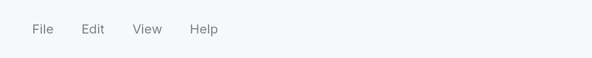

<!-- SPDX-License-Identifier: MPL-2.0 -->
<!-- SPDX-FileCopyrightText: 2026 FernTech -->

# MenuBar


MenuBar — a horizontal application menu bar with keyboard-driven dropdowns.

## Public types

| Kind | Name |
| ---: | :--- |
| `enum` | [`CollapsePolicy`](#collapsepolicy) — Controls when a collapsible `MenuBar` switches from the full inline bar to the hamburger `IconButton` representation |
| `struct` | [`MenuBar`](#menubar) — A horizontal application menu bar with labelled trigger buttons and dropdown menus |

## Public functions

### `MenuBar`

| Returns | Function |
| ---: | :--- |
| | **Constructors** |
| `Self` | [`new()`](#menubar-new) |
| `Self` | [`from_model(model: crate::menu::MenuModel)`](#menubar-from_model) |
| `Self` | [`application()`](#menubar-application) |
| | **Builder methods** |
| `Self` | [`native_on_macos(mode: crate::menu::NativeMenuMode)`](#menubar-native_on_macos) |
| `Self` | [`collapsible()`](#menubar-collapsible) |
| `Self` | [`collapsed_signal(collapsed: Signal<bool>)`](#menubar-collapsed_signal) |
| `Self` | [`collapse_policy(policy: CollapsePolicy)`](#menubar-collapse_policy) |
| `Self` | [`hamburger_size(size: IconButtonSize)`](#menubar-hamburger_size) |
| `Self` | [`no_dispatcher_install()`](#menubar-no_dispatcher_install) |
| `Self` | [`menu(label: impl Into<LocalizedString>, factory: impl Fn() -> Box<dyn Widget> + 'static)`](#menubar-menu) |
| `Self` | [`leading_slot(widget: impl Widget + 'static)`](#menubar-leading_slot) |
| `Self` | [`leading_slots(iter: impl IntoIterator<Item = impl Widget + 'static>)`](#menubar-leading_slots) |
| `Self` | [`trailing_slot(widget: impl Widget + 'static)`](#menubar-trailing_slot) |
| `Self` | [`trailing_slots(iter: impl IntoIterator<Item = impl Widget + 'static>)`](#menubar-trailing_slots) |
| | **Methods** |
| `Signal<bool>` | [`is_collapsed()`](#menubar-is_collapsed) |

## Detailed description

`MenuBar` renders a row of labelled trigger buttons; activating one opens a
dropdown `MenuList` as an overlay. Leading and trailing slots accept
arbitrary widget content (an app icon or a search field, for example).

**What it shows.** `MenuBar::application()` shows the application menu,
the one declarative `MenuModel` the application tree declares with
`ctx.set_application_menu(model)`, and follows it when it changes. On
Windows and Linux this is how a window shows the application menu: nothing
puts it in a window by itself. On macOS the application menu is the global
menu bar already, so by default the bar renders only its slots there.
`MenuBar::from_model(model)` shows a menu of the window's own instead, which
`native_on_macos` mirrors into the global bar while the window is key.
Menus can also be added one by one with the fluent `.menu(label, factory)`
API, for a bar that is no model's.

**Rows of a model.** A row's intent is sent from the window's focus, so the
window's actions take it first and the application tree takes what the
window leaves; a row of the application menu runs its `on_activate`
closure in the application tree. A row with an intent and no closure is
greyed out while nothing on that route takes the intent, and follows it
while its menu is open.

**Focus.** A trigger takes no focus from a click (`focus_on_click(false)`):
a menu opened with the mouse or a finger opens over the widget the user is
working in, which keeps focus, and gets it back when the menu closes,
however it closes. A command chosen there, sent from focus, acts on it.

**Keyboard.** F10 and bare-Alt-tap focus the first trigger without opening
a menu; Alt+letter opens the menu whose label carries a matching mnemonic
marker (`&File` → Alt+F). On macOS the Alt+letter branch is suppressed
because the OS rewrites Option+letter for accented character composition;
F10 and bare-Alt-tap continue to work. Once a dropdown is open, ArrowLeft
and ArrowRight cycle between top-level menus, and Escape closes the active
one and leaves focus on its trigger, as Windows menu bars do; Escape on a
trigger gives focus back to the widget focused before the bar took it.
Choosing a command, or clicking the menu away, gives it back too, before
the command is sent, so it acts on that widget. The triggers stay Tab
stops.

**Hamburger / collapsible mode.** Call `.collapsible()` to let the bar
collapse to a single hamburger `IconButton` when its intrinsic width
exceeds the allotted space (`CollapsePolicy::Responsive`). `.collapse_policy(Always)`
forces the hamburger regardless of width.

#### Accessibility

The bar carries `Role::MenuBar`; each trigger is `Role::MenuItem` with
`set_has_popup(Menu)` and `set_expanded` tracking the open dropdown.
Mnemonic letters are announced via `set_access_key` for Windows Narrator.

```rust
# use teksilo_widgets::MenuBar;
// In a window's build: the application menu.
let _bar = MenuBar::application();
```

A bar built by hand, with no model:

```rust
# use teksilo_widgets::{MenuBar, MenuList, MenuItem};
# use teksilo_i18n::lit;
# use teksilo_core::Intent;
let _w = MenuBar::new()
    .menu(lit!("File"), || Box::new(
        MenuList::new()
            .item(MenuItem::new(lit!("New")).on_activate_fn(|ctx| ctx.send_intent(Intent::new("app.new"))))
            .separator()
            .item(MenuItem::new(lit!("Quit")).on_activate_fn(|ctx| ctx.send_intent(Intent::new("app.quit"))))
    ))
    .menu(lit!("Edit"), || Box::new(
        MenuList::new()
            .item(MenuItem::new(lit!("Cut")).on_activate_fn(|ctx| ctx.send_intent(Intent::new("app.cut"))))
    ));
```

## Density

The picture above is the widget at `TargetDensity::Compact`, the mouse-and-keyboard ladder. Below is the same subject on the same canvas with only the ladder changed, so what moves is the density and nothing else — where the subject no longer fits, that is what the denser targets cost it at that size. See `docs/density-and-targets.md`.

**Touch**



## API reference

📖 [Full rustdoc API for this module](https://docs.rs/teksilo-widgets/latest/teksilo_widgets/menu_bar/index.html)

<a id="collapsepolicy"></a>

## `pub enum CollapsePolicy`

**Import:** `use teksilo::widgets::CollapsePolicy;`

Controls when a collapsible `MenuBar` switches from the full inline bar
to the hamburger `IconButton` representation.

```rust
pub enum CollapsePolicy { /* variants */ }
```

### Variants

- **`Responsive`** — Collapse to a hamburger only when the bar's intrinsic width exceeds the width it is allotted; otherwise show the full inline bar. Mirrors the responsive `Toolbar` overflow behaviour.
- **`Always`** — Always show the hamburger, regardless of available width. The "force hamburger" / compact mode.

<a id="menubar"></a>

## `pub struct MenuBar`

**Import:** `use teksilo::widgets::MenuBar;`

A horizontal application menu bar with labelled trigger buttons and dropdown menus.

Each top-level entry becomes a focusable trigger; activating it opens a
floating `MenuList` overlay. See the module documentation for the full
keyboard, mnemonic, and collapsible-mode details.

```rust
pub struct MenuBar { /* fields */ }
```

### Methods

<a id="menubar-new"></a>

#### `pub fn new() -> Self`

Create an empty menu bar with no menus, slots, or collapse policy.

<a id="menubar-from_model"></a>

#### `pub fn from_model(model: crate::menu::MenuModel) -> Self`

Build a menu bar from a declarative `MenuModel`
— the single source of truth shared with the native OS menu bar. Each
top-level menu in the model becomes an in-window dropdown; combine with
`native_on_macos` to also mirror it into the
macOS system menu bar.

<a id="menubar-application"></a>

#### `pub fn application() -> Self`

A bar showing the application menu, the one the application tree
declares with
`set_application_menu`.

It renders that menu as `from_model` renders a
model, and follows it: a menu declared again, or a model changed in
place, rebuilds the bar in every window that shows one. A row's intent
is sent from this window's focus, so an action of the window takes it
(Edit ▸ Copy copies in the focused field) and the application tree's
actions take what the window leaves; a row's
`on_activate` closure runs in
the application tree.

On Windows and Linux this is how a window shows the application menu:
nothing puts it in a window by itself. On macOS, in an application
that called `install_native_menu()`, the application menu is the
global menu bar already, so by default this bar renders only its
leading and trailing slots there; `.native_on_macos(NativeMenuMode::Coexist)`
keeps the in-window bar too.

With no application menu declared the bar shows no menu (and a debug
build says so once), as it does in a tree that belongs to no
application (a test, a tree built by hand; said once per process).

<a id="menubar-native_on_macos"></a>

#### `pub fn native_on_macos(mut self, mode: crate::menu::NativeMenuMode) -> Self`

Choose how this bar behaves on macOS, where the convention is a global
menu bar at the top of the screen. Requires the bar to have been built
with `from_model` or
`application` and the app to have called
`install_native_menu()`. No effect on other platforms (the in-window bar
renders there regardless).

For a `from_model` bar the mode decides whether the window's model is
mirrored into the global bar while the window is key. An
`application` bar mirrors nothing (the application menu is the global
bar already), so its mode only decides whether the in-window bar shows
too: `Suppress`, its default,
hides it, the other two keep it.

<a id="menubar-collapsible"></a>

#### `pub fn collapsible(mut self) -> Self`

Enable the optional **hamburger** representation. When there
isn't room for the full inline bar, it collapses to a single
hamburger (☰) `IconButton`; activating it (click, `Alt`+
mnemonic, `F10`, or bare-`Alt`-tap) reveals the full bar as a
floating overlay over content. Clicking outside the bar or
pressing `Escape` hides it again.

Uses `CollapsePolicy::Responsive`. Observe the collapsed state
via `is_collapsed`, or bind your own signal
with `collapsed_signal`.

<a id="menubar-collapsed_signal"></a>

#### `pub fn collapsed_signal(mut self, collapsed: Signal<bool>) -> Self`

Like `collapsible`, but uses the supplied
signal as the collapsed-state source so the application can
observe (and react to) collapse transitions. The responsive
decision **writes** this signal (it is not a plain read-only
input) — kept as a `Signal<bool>` rather than `Prop<bool>` since a
static value would have nowhere to receive those writes.

<a id="menubar-collapse_policy"></a>

#### `pub fn collapse_policy(mut self, policy: CollapsePolicy) -> Self`

Set the collapse policy (and enable collapsible mode).
`CollapsePolicy::Always` forces the hamburger regardless of
available width — i.e. **collapsed by default**.

<a id="menubar-hamburger_size"></a>

#### `pub fn hamburger_size(mut self, size: IconButtonSize) -> Self`

Set the size variant of the collapsed-mode hamburger
`IconButton`. Mirrors `IconButton::size` — pick
`IconButtonSize::Toolbar`, `IconButtonSize::Large`,
`IconButtonSize::Hero`, etc. so the hamburger matches the
surrounding chrome. Defaults to `IconButtonSize::Default`.

<a id="menubar-is_collapsed"></a>

#### `pub fn is_collapsed(&self) -> Signal<bool>`

A clone of the collapsed-state signal (`true` while the
hamburger is shown). Call after `collapsible`.

<a id="menubar-no_dispatcher_install"></a>

#### `pub fn no_dispatcher_install(mut self) -> Self`

Skip the window-state dispatcher install. The MenuBar still
renders, intercepts mouse clicks, and supports keyboard
navigation when its triggers have focus — only F10 /
Alt+letter / Alt-tap routing through the window-level slot is
disabled. Use this for demo / showcase MenuBars that share a
window with a primary functional MenuBar — the slot is
single-occupancy and a second install would `debug_assert!`.

<a id="menubar-menu"></a>

#### `pub fn menu( mut self, label: impl Into<LocalizedString>, factory: impl Fn() -> Box<dyn Widget> + 'static, ) -> Self`

Add a top-level menu entry. `label` is the trigger text (supports `&`
mnemonic markers, e.g. `"&File"`); `factory` is called each build to
produce the dropdown content — typically a `MenuList`.

<a id="menubar-leading_slot"></a>

#### `pub fn leading_slot(mut self, widget: impl Widget + 'static) -> Self`

Add content before the menu buttons (e.g. an app icon). Call more than
once to stack several.

Takes the widget by value, like every other widget's slot. MenuBar
builds it once and reuses it across rebuilds (it
`preserves_children_on_rebuild`),
so the slot — and any state it holds — survives a theme / locale /
model-version rebuild.

<a id="menubar-leading_slots"></a>

#### `pub fn leading_slots(self, iter: impl IntoIterator<Item = impl Widget + 'static>) -> Self`

Add several widgets before the menu buttons, in iterator order.

The loop form of `leading_slot`, which already
stacks on repeat calls: this is the same thing in one call.

<a id="menubar-trailing_slot"></a>

#### `pub fn trailing_slot(mut self, widget: impl Widget + 'static) -> Self`

Add content after the menu buttons (e.g. a search box or avatar).
Like `leading_slot`, taken by value and preserved
across rebuilds.

<a id="menubar-trailing_slots"></a>

#### `pub fn trailing_slots(self, iter: impl IntoIterator<Item = impl Widget + 'static>) -> Self`

Add several widgets after the menu buttons, in iterator order.

The loop form of `trailing_slot`, which already
stacks on repeat calls: this is the same thing in one call.
