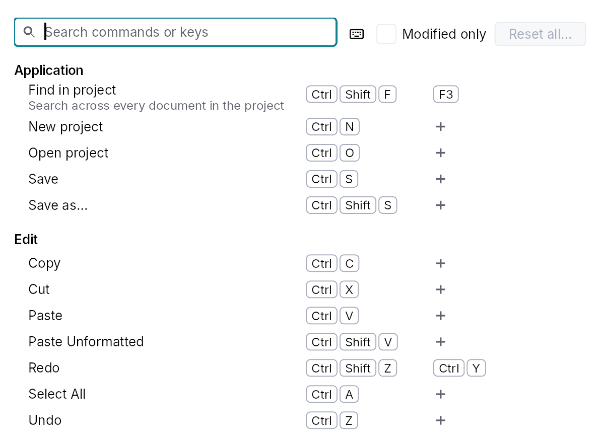
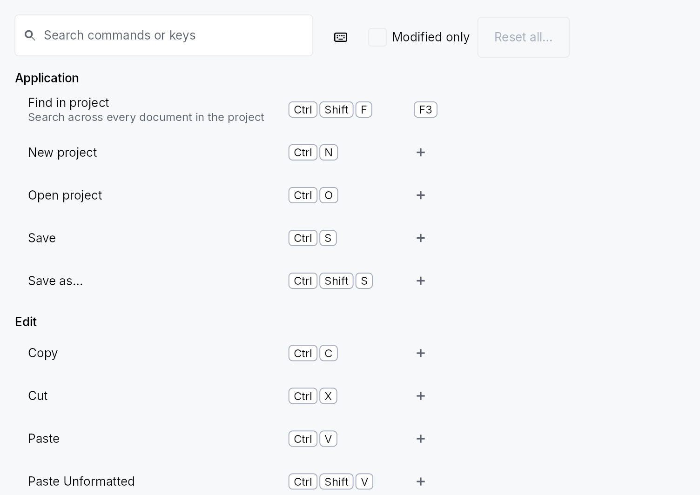

<!-- SPDX-License-Identifier: MPL-2.0 -->
<!-- SPDX-FileCopyrightText: 2026 FernTech -->

# ShortcutSettings



ShortcutSettings: the user-facing panel for browsing and rebinding an
application's shortcuts.

## Public types

| Kind | Name |
| ---: | :--- |
| `struct` | [`ShortcutConflict`](#shortcutconflict) — Describes a rebind that collides with an existing binding |
| `struct` | [`ShortcutSettings`](#shortcutsettings) — A settings panel for browsing and rebinding application shortcuts |

## Public functions

### `ShortcutSettings`

| Returns | Function |
| ---: | :--- |
| | **Constructors** |
| `Self` | [`new()`](#shortcutsettings-new) |
| | **Builder methods** |
| `Self` | [`with_filter(filter: Signal<String>)`](#shortcutsettings-with_filter) |
| `Self` | [`modified_only(signal: Signal<bool>)`](#shortcutsettings-modified_only) |
| `Self` | [`toolbar(show: bool)`](#shortcutsettings-toolbar) |
| `Self` | [`confirm_conflicts(yes: bool)`](#shortcutsettings-confirm_conflicts) |
| `Self` | [`on_conflict(f: impl Fn(&ShortcutConflict) + 'static)`](#shortcutsettings-on_conflict) |

## Detailed description

It lists every shortcut in the tree's
`ShortcutRegistry`, grouped
by category, one row per command:

```text
 [ Search commands or keys         ] [⌨]  [ ] Modified only  [Reset all…]

 File
    New project                 [Ctrl] [N]          +
    Open…                       [Ctrl] [O]          +
  ● Save                        [Ctrl] [Shift] [S]  [Ctrl] [S]   ↺
 Format
    Bold                        ( Press keys… )     +
       Press the new shortcut. Esc cancels, Del removes it.
```

- **The chord is the control.** Each chord is drawn as key caps; click
  it (or focus it and press Enter or Space) to record a new one. The
  first column is the shortcut, the second its alternative (`+` adds
  one). Delete or Backspace on a focused chord removes it.
- **Recording** shows "Press keys…" in a field the width of its column,
  so the list never reflows. Escape or Tab cancels; Delete or Backspace
  removes the chord; leaving the field cancels too. A key that cannot be
  a shortcut is refused with the reason, and recording goes on: a
  printable key needs Ctrl, Alt or ⌘ (Shift alone types a capital), and
  chords the system keeps (Alt+F4, Alt+Tab, ⌘Tab, ⌘Space, …) and
  Ctrl+Tab (the way out of a control that keeps Tab) are reserved.
- **Conflicts are confirmed.** A chord another command already uses
  is not taken from it until the user presses "Reassign" on the line
  that appears under the row. `confirm_conflicts(false)` reassigns at
  once instead; either way `on_conflict` is told.
- **Changed rows are marked** with a dot and get a reset button, which
  puts that command's declared defaults back. "Reset all…" in the
  toolbar does it for every command, after a confirmation.
- **Search** matches a command's name, its group, its description and
  the text of its chords ("ctrl+s" finds Save). The keyboard button
  next to the field finds by chord instead: press it, press the keys,
  and the list shows the commands that use exactly that chord.
  "Modified only" narrows the list to the commands the user changed.

Commands are sorted by name within a group and groups by their title,
both in the interface language. Every visible string comes from the
framework's locale bundles.

**Keyboard.** The list is one Tab stop. The arrow keys move between rows
and between a row's chord, alternative and reset button; Home and End go
to the first and last row. Every control carries its command in its
accessible name ("Save: Ctrl+S"), its description and whether the user
changed it in its description, and the group titles are headings.

The widget owns the armed key capture. Dropping the widget cancels it,
so navigating away mid-recording cannot rebind the next key pressed
somewhere else.

The list grows with its content and does not scroll; place the widget
in a `ScrollArea` when there are more shortcuts than fit.

```ignore
// Inside a settings Dialog build():
ctx.add(
    ShortcutSettings::new()
        .on_conflict(|c| println!("{} loses its shortcut", c.displaced_name)),
);
```


## Density

The picture above is the widget at `TargetDensity::Compact`, the mouse-and-keyboard ladder. Below is the same subject on the same canvas with only the ladder changed, so what moves is the density and nothing else — where the subject no longer fits, that is what the denser targets cost it at that size. See `docs/density-and-targets.md`.

**Touch**



## API reference

📖 [Full rustdoc API for this module](https://docs.rs/teksilo-widgets/latest/teksilo_widgets/shortcut_settings/index.html)

<a id="shortcutconflict"></a>

## `pub struct ShortcutConflict`

**Import:** `use teksilo::widgets::shortcut_settings::ShortcutConflict;`

Describes a rebind that collides with an existing binding.

Passed to the `ShortcutSettings::on_conflict` callback so the app
can surface a toast ("Save lost its Ctrl+S binding").

```rust
pub struct ShortcutConflict { /* fields */ }
```

### Fields

- **`displaced_id`**: `String` — Id of the shortcut that currently owns the chord and loses it if the rebind goes ahead.
- **`displaced_name`**: `String` — Display name of that shortcut (its registry `name`).
- **`keystroke`**: `KeyStroke` — The chord being assigned to the new target.

<a id="shortcutsettings"></a>

## `pub struct ShortcutSettings`

**Import:** `use teksilo::widgets::ShortcutSettings;`

A settings panel for browsing and rebinding application shortcuts.

See the module documentation for what it shows and how it behaves.

```rust
pub struct ShortcutSettings { /* fields */ }
```

### Methods

<a id="shortcutsettings-new"></a>

#### `pub fn new() -> Self`

A panel listing every shortcut registered in the tree's
`ShortcutRegistry`, with its toolbar, asking before it takes a chord
from another command.

<a id="shortcutsettings-with_filter"></a>

#### `pub fn with_filter(mut self, filter: Signal<String>) -> Self`

Bind the search text to `filter`. The toolbar's search field edits
this signal, and anything else may write it too: a command palette
handing a query over, an app's own search box when the toolbar is
off. The list shows the shortcuts whose name, group, description or
chord contains the text (case-insensitive); an empty string shows
everything.

<a id="shortcutsettings-modified_only"></a>

#### `pub fn modified_only(mut self, signal: Signal<bool>) -> Self`

Bind "Modified only" to `signal`: while it is `true` the list shows
only the shortcuts the user changed. The toolbar's checkbox edits
the same signal.

<a id="shortcutsettings-toolbar"></a>

#### `pub fn toolbar(mut self, show: bool) -> Self`

Show the toolbar (search field, find by keys, "Modified only",
"Reset all…"). On by default. Turn it off when the surrounding UI
already has a search field, and drive the list through
`with_filter` and
`modified_only`.

<a id="shortcutsettings-confirm_conflicts"></a>

#### `pub fn confirm_conflicts(mut self, yes: bool) -> Self`

Ask before a rebind takes a chord from another shortcut. On by
default: the colliding rebind shows "{chord} is already used by
{command}" under the row with Reassign and Cancel, and nothing
changes until the user answers. With `false` the other shortcut
loses the chord at once, and a screen reader is told which one.

<a id="shortcutsettings-on_conflict"></a>

#### `pub fn on_conflict(mut self, f: impl Fn(&ShortcutConflict) + 'static) -> Self`

Register a callback fired whenever a rebind collides with an
existing binding, **regardless** of `confirm_conflicts`. The
callback receives the displaced shortcut's id, name, and the
chord, so the app can surface a toast. It fires before the
displaced binding is removed (when asking first, before the user
has answered).

