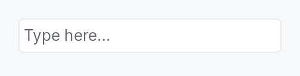
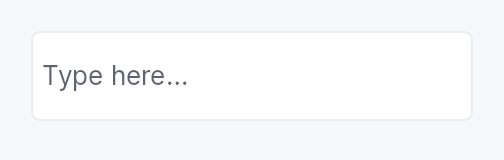

<!-- SPDX-License-Identifier: MPL-2.0 -->
<!-- SPDX-FileCopyrightText: 2026 FernTech -->

# TextInput



`TextInput` — styled single-line text field composite.

## Public types

| Kind | Name |
| ---: | :--- |
| `enum` | [`ValidationState`](#validationstate) — Validation state for the text input field |
| `struct` | [`TextInput`](#textinput) — Styled single-line text input composite |

## Public functions

### `TextInput`

| Returns | Function |
| ---: | :--- |
| | **Constructors** |
| `Self` | [`new(text: Signal<String>)`](#textinput-new) |
| | **Builder methods** |
| `Self` | [`variant(variant: TextInputVariant)`](#textinput-variant) |
| `Self` | [`style(style: impl TextInputStyle)`](#textinput-style) |
| `Self` | [`placeholder(text: impl Into<LocalizedString>)`](#textinput-placeholder) |
| `Self` | [`label(label: impl Into<LocalizedString>)`](#textinput-label) |
| `Self` | [`enabled(enabled: impl Into<Prop<bool>>)`](#textinput-enabled) |
| `Self` | [`read_only(read_only: bool)`](#textinput-read_only) |
| `Self` | [`max_length(max_length: usize)`](#textinput-max_length) |
| `Self` | [`show_clear_button(show: bool)`](#textinput-show_clear_button) |
| `Self` | [`min_width(w: f32)`](#textinput-min_width) |
| `Self` | [`min_height(height: f32)`](#textinput-min_height) |
| `Self` | [`text_style(style: impl Into<TextStyleProp>)`](#textinput-text_style) |
| `Self` | [`text_alignment(alignment: HAlignment)`](#textinput-text_alignment) |
| `Self` | [`text_color(color: impl Into<ColorProp>)`](#textinput-text_color) |
| `Self` | [`leading_slot(widget: impl Widget + 'static)`](#textinput-leading_slot) |
| `Self` | [`trailing_slot(widget: impl Widget + 'static)`](#textinput-trailing_slot) |
| `Self` | [`on_submit_fn(f: impl Fn(&mut EventContext) + 'static)`](#textinput-on_submit_fn) |
| `Self` | [`on_access_set_value(f: impl Fn(&str, &mut EventContext) -> bool + 'static)`](#textinput-on_access_set_value) |
| `Self` | [`on_blur_fn(f: impl Fn(&mut EventContext) + 'static)`](#textinput-on_blur_fn) |
| `Self` | [`char_filter(f: impl Fn(char) -> bool + 'static)`](#textinput-char_filter) |
| `Self` | [`suffix(text: impl Into<String>)`](#textinput-suffix) |
| `Self` | [`input_mask(mask: impl Into<String>)`](#textinput-input_mask) |
| `Self` | [`input_purpose(purpose: crate::primitives::text_input_field::InputPurpose)`](#textinput-input_purpose) |
| `Self` | [`active_descendant(active: Signal<Option<WidgetId>>)`](#textinput-active_descendant) |
| `Self` | [`controls(listbox: Signal<Option<WidgetId>>)`](#textinput-controls) |
| `Self` | [`validator(f: impl Fn(&str) -> crate::primitives::text_input_field::ValidationOutcome + 'static)`](#textinput-validator) |
| `Self` | [`validation(validation: impl Into<Prop<ValidationState>>)`](#textinput-validation) |
| `Self` | [`validation_feedback(feedback: Signal<ValidationFeedback>)`](#textinput-validation_feedback) |
| `Self` | [`tooltip(text: impl Into<LocalizedString>)`](#textinput-tooltip) |
| `Self` | [`rich_tooltip_key(key: impl Into<String>)`](#textinput-rich_tooltip_key) |
| `Self` | [`rich_tooltip(content: tooltip::TooltipContent)`](#textinput-rich_tooltip) |
| `Self` | [`rich_tooltip_content(content: crate::tooltip::TooltipContent)`](#textinput-rich_tooltip_content) |
| `Self` | [`composite_tooltip(content: impl teksilo_core::widget::Widget + 'static)`](#textinput-composite_tooltip) |
| | **Methods** |
| `Signal<usize>` | [`caret_position()`](#textinput-caret_position) |
| `crate::primitives::TextFieldHandle` | [`handle()`](#textinput-handle) |
| `std::rc::Rc<std::cell::Cell<Option<WidgetId>>>` | [`field_id()`](#textinput-field_id) |
| `std::rc::Rc<dyn Fn(usize)>` | [`caret_setter()`](#textinput-caret_setter) |
| `Signal<ValidationFeedback>` | [`validation_feedback_signal()`](#textinput-validation_feedback_signal) |
| `Signal<String>` | [`text()`](#textinput-text) |

## Detailed description

Wraps the `TextInputField`
editing primitive in a bordered, padded frame with placeholder
overlay, validation, optional clear button, and leading/trailing
slots. All actual text editing is delegated to the field: every
configuration method here has a direct counterpart on the
primitive.

Most applications want `TextInput`. Choose
`TextInputField` directly
when you're building a composite of your own that already
supplies its frame — `SpinBox` is the canonical in-tree example.

### Example

```ignore
let search = ctx.signal(String::new());
TextInput::new(search.clone())
    .placeholder("Search...")
    .show_clear_button(true)
    .leading_slot(IconWidget::from_svg(SEARCH_ICON))
    .on_submit_fn(|ctx| ctx.send_intent(AppIntent::Search))
```

#### Appearance

- `text_style` — the size, family and weight of
  the typed text and of the placeholder, from a `TextStyleRole` (follows the
  theme) or a fixed `TextStyle`. The field's height follows the style's
  line, so a small style gives a short field and a large one a tall field.
- `text_alignment` — where a text narrower
  than the field sits: start, centre or end, mirrored in a right-to-left
  layout. A longer text scrolls as usual.
- `text_color` — the colour of the text and the
  caret. A disabled field still greys out. For one colour at rest and
  another while editing, map the field's focus:
  `input.handle().focused_signal().map(|f| if *f { TextRole::Primary } else
  { TextRole::Secondary })`.
- `min_height` — replaces the minimum height the
  style and the density would give the field. Below 24 dp the field fails
  WCAG 2.5.8 unless the app offers a larger target for it.

None of them is set by default, and the field then looks as it always has.

#### Touch and pen

The trailing clear affordance is 16 dp of paint and a 24 dp target: raising
its box would widen every field in the workspace at Compact, so the
shortfall is made up between the pointer and the arena through
`Widget::hit_outset` — declared by the slot that takes the tap, because the
ring around an outset resolves to the declaring node rather than to a
descendant, and by a direct child of the row, because an outset never
escapes its parent. The slot keeps its 16 dp while the affordance is hidden
so the row does not jump, and withdraws its outset while there is nothing to
clear. The caret and selection behaviour of the field itself belongs to the
touch-text package.

## Density

The picture above is the widget at `TargetDensity::Compact`, the mouse-and-keyboard ladder. Below is the same subject on the same canvas with only the ladder changed, so what moves is the density and nothing else — where the subject no longer fits, that is what the denser targets cost it at that size. See `docs/density-and-targets.md`.

**Touch**



## API reference

📖 [Full rustdoc API for this module](https://docs.rs/teksilo-widgets/latest/teksilo_widgets/text_input/index.html)

<a id="validationstate"></a>

## `pub enum ValidationState`

**Import:** `use teksilo::widgets::ValidationState;`

Validation state for the text input field.

Drives the inline feedback strip and border tint of `TextInput`.

```rust
pub enum ValidationState { /* variants */ }
```

### Variants

- **`None`** — No validation message — the field is pristine or valid.
- **`Error`** `(LocalizedString)` — The committed value is invalid; `LocalizedString` is shown in red below the field.
- **`Warning`** `(LocalizedString)` — The committed value is suspicious but accepted; `LocalizedString` is shown as a warning.
- **`Corrected`** `(LocalizedString)` — Last commit was auto-corrected; the field's value has already been replaced with the normalized form. The composite renders the message in secondary text and tints the border accent briefly (decay-managed by the framework's frame loop, not a concern of this enum).

<a id="textinput"></a>

## `pub struct TextInput`

**Import:** `use teksilo::widgets::TextInput;`

Styled single-line text input composite.

See the `module-level documentation` for usage examples.

```rust
pub struct TextInput { /* fields */ }
```

### Methods

<a id="textinput-new"></a>

#### `pub fn new(text: Signal<String>) -> Self`

Construct a new text input bound to `text`.

<a id="textinput-variant"></a>

#### `pub fn variant(mut self, variant: TextInputVariant) -> Self`

Pick a Tier-1 design-language variant
(`TextInputVariant::Outlined` / `Filled` / `Underline` / `Bare`).
The IntUI default (`crate::styles::RecipeTextInputStyle`) honours
`Outlined`, `Filled`, and `Bare`; `Underline` falls back to
`Outlined` until per-side stroke recipes land.

<a id="textinput-style"></a>

#### `pub fn style(mut self, style: impl TextInputStyle) -> Self`

Override the active `TextInputStyle` for this widget instance
only. The widget keeps responsibility for caret blinking, IME
composition, the placeholder layering, the leading / trailing
slots and the validation strip — the style only paints the
frame (border / fill / corner radius).

<a id="textinput-placeholder"></a>

#### `pub fn placeholder(mut self, text: impl Into<LocalizedString>) -> Self`

Set the placeholder text shown when the field is empty.

<a id="textinput-label"></a>

#### `pub fn label(mut self, label: impl Into<LocalizedString>) -> Self`

Accessible name for the field.

Applied to the inner `TextInputField` — the node that carries
`Role::TextInput`, holds focus, and reports the document's value.
It deliberately does *not* go on the composite's outer node: that
node is a `Role::GenericContainer`, which
`accesskit_consumer::common_filter` drops from the filtered tree
unconditionally, so a name placed there would be invisible to every
screen reader on every platform.

Stays locale-reactive: a `tr!(...)` name is re-resolved when the
locale changes, without a rebuild.

<a id="textinput-enabled"></a>

#### `pub fn enabled(mut self, enabled: impl Into<Prop<bool>>) -> Self` (default: `true`)

Set the enabled state, statically or reactively. Forwarded to the
arena and the inner `TextInputField` at build time.

<a id="textinput-read_only"></a>

#### `pub fn read_only(mut self, read_only: bool) -> Self` (default: `false`)

Set the field read-only: text is selectable and copyable but not editable.

<a id="textinput-max_length"></a>

#### `pub fn max_length(mut self, max_length: usize) -> Self` (default: `None`)

Limit the number of Unicode scalar values the field will accept.

<a id="textinput-show_clear_button"></a>

#### `pub fn show_clear_button(mut self, show: bool) -> Self`

Show or hide the trailing ✕ button that clears the field text. Default: hidden.

<a id="textinput-min_width"></a>

#### `pub fn min_width(mut self, w: f32) -> Self`

Override the frame's intrinsic minimum width (default 65 dp).
Use to express a design width for date / time / phone-number
fields whose content is well-known and whose collapse to the
generic 65 dp floor would look out of place.

<a id="textinput-min_height"></a>

#### `pub fn min_height(mut self, height: f32) -> Self`

Override the field's minimum height, in logical pixels.

By default the field is at least the style's control height — 28 dp
in the IntUI style, raised to the density's target size — or, when a
`text_style` is set, at least the density's target
size, with the style's line deciding the rest. This replaces that
floor with `height`, as given: the field still grows to fit its text,
and is centred in a taller box. The value reaches the active
`TextInputStyle` through `TextInputStyleConfig::min_height`; a
style that ignores it keeps its own minimum.

The field is the pointer target: a press anywhere in it places the
caret. Below 24 dp it fails WCAG 2.2 SC 2.5.8 *Target Size (Minimum)*
unless the app gives the same function a larger target elsewhere — an
enclosing row that focuses the field when pressed, say.

<a id="textinput-text_style"></a>

#### `pub fn text_style(mut self, style: impl Into<TextStyleProp>) -> Self` (default: `None`)

The style the typed text is shaped in: its size, family and weight.

Forwarded to `TextInputField::text_style`, where the details live,
and given to the placeholder too, so the hint and the text it stands in
for read alike. The field's height follows the style's line: an 11 px
style gives a short field, a large one a tall field (see
`min_height` for the floor). A role tracks the
theme; the global text scale multiplies the size.

<a id="textinput-text_alignment"></a>

#### `pub fn text_alignment(mut self, alignment: HAlignment) -> Self` (default: `None`)

Where the text — and the placeholder — sits when it is narrower than
the field: at its start, in the middle, or at its end, mirrored in a
right-to-left layout. Text wider than the field scrolls as usual.
Forwarded to `TextInputField::text_alignment`.

<a id="textinput-text_color"></a>

#### `pub fn text_color(mut self, color: impl Into<ColorProp>) -> Self` (default: `None`)

The colour of the typed text and of the caret: a colour, a theme role
or a signal of either, resolved every paint. A disabled field still
paints the theme's disabled text colour. Forwarded to
`TextInputField::text_color`.

A different colour at rest and while editing follows the field's
focus, which `handle` exposes before the input is
built:

```ignore
let input = TextInput::new(text);
let focused = input.handle().focused_signal();
let input = input.text_color(focused.map(|f| {
    if *f { TextRole::Primary } else { TextRole::Secondary }
}));
```

<a id="textinput-leading_slot"></a>

#### `pub fn leading_slot(mut self, widget: impl Widget + 'static) -> Self`

Set an arbitrary widget in the leading slot (before the text area).
Typically an `IconButton` or `IconWidget`.

<a id="textinput-trailing_slot"></a>

#### `pub fn trailing_slot(mut self, widget: impl Widget + 'static) -> Self`

Set an arbitrary widget in the trailing slot (after the text area).
Typically an `IconButton` or `IconWidget`.

<a id="textinput-on_submit_fn"></a>

#### `pub fn on_submit_fn(mut self, f: impl Fn(&mut EventContext) + 'static) -> Self`

Closure invoked on Enter. Forwarded to `TextInputField`.

<a id="textinput-on_access_set_value"></a>

#### `pub fn on_access_set_value( mut self, f: impl Fn(&str, &mut EventContext) -> bool + 'static, ) -> Self`

Handle an assistive technology's whole-value write, given the string it
set. Forwarded 1:1 to `TextInputField::on_access_set_value`, where the
reasoning lives. Composites whose text projects a typed value —
`SpinBox`, the date and time editors — install one.

<a id="textinput-on_blur_fn"></a>

#### `pub fn on_blur_fn(mut self, f: impl Fn(&mut EventContext) + 'static) -> Self`

Closure invoked once per focus loss, after the field has committed
(its `validator` has run). Only a real focus loss
invokes it: a click on a control that takes no focus (a toolbar
button) has the field commit while it keeps focus, and this waits for
focus to leave. Forwarded to `TextInputField`.

<a id="textinput-char_filter"></a>

#### `pub fn char_filter(mut self, f: impl Fn(char) -> bool + 'static) -> Self`

Per-character input-filter predicate. Forwarded to
`TextInputField`.

<a id="textinput-suffix"></a>

#### `pub fn suffix(mut self, text: impl Into<String>) -> Self` (default: `String::new()`)

Non-editable trailing string (Qt's `QSpinBox::suffix`).
Forwarded to `TextInputField`.

<a id="textinput-input_mask"></a>

#### `pub fn input_mask(mut self, mask: impl Into<String>) -> Self` (default: `None`)

Install an input mask (Qt grammar). Forwarded 1:1 to
`TextInputField::input_mask`. Composing widgets like
`DateEdit` use this to project the date format pattern
onto the editing surface.

<a id="textinput-input_purpose"></a>

#### `pub fn input_purpose( mut self, purpose: crate::primitives::text_input_field::InputPurpose, ) -> Self` (default: `crate::primitives::text_input_field::InputPurpose::Normal`)

Declare the field's semantic `InputPurpose`
(WCAG 1.3.5), forwarded to the inner `TextInputField` to select a
specialised AT role (e.g. `Role::EmailInput`).

<a id="textinput-active_descendant"></a>

#### `pub fn active_descendant(mut self, active: Signal<Option<WidgetId>>) -> Self` (default: `None`)

Publish `active_descendant` on the inner field, pointing at the row a
separate listbox is currently highlighting (the ARIA combobox pattern).
Forwarded 1:1 to `TextInputField::active_descendant`, which is where
it has to land: AT follows the *focused* node's active descendant, and
the inner field is the focusable one.

<a id="textinput-controls"></a>

#### `pub fn controls(mut self, listbox: Signal<Option<WidgetId>>) -> Self` (default: `None`)

Publish a `controls` relation to the listbox this input drives.
Forwarded 1:1 to `TextInputField::controls`.

<a id="textinput-validator"></a>

#### `pub fn validator( mut self, f: impl Fn(&str) -> crate::primitives::text_input_field::ValidationOutcome + 'static, ) -> Self`

Install a commit-time validator. Forwarded 1:1 to
`TextInputField::validator`. Pair with
`Self::validation_feedback_signal` (or
`Self::validation_feedback`) to surface the outcome
in the inline strip.

<a id="textinput-caret_position"></a>

#### `pub fn caret_position(&self) -> Signal<usize>`

Reactive caret position. Mirrors the inner field's
`TextInputField::caret_position` after `build`. Capture
before `ctx.add(text_input)` — used by composing widgets
(`DateEdit` segment-stepping) that need to know which
segment Up/Down should step.

<a id="textinput-handle"></a>

#### `pub fn handle(&self) -> crate::primitives::TextFieldHandle`

A live handle on the inner field — its text-editing commands, for a
host outside the widget.

Mirrors `TextInputField::handle`, and exists for the same reason: an
application that routes Undo, Cut, Copy, Paste and Select All to
"whichever text surface holds the caret" must be able to reach *every*
such surface. A `TextInput` that could not be reached would silently
lose its own Ctrl+Z to whatever the host routed the chord at instead.

Like `caret_setter`, safe to take before `build`:
the handle reaches the field through a slot the widget fills in.

<a id="textinput-field_id"></a>

#### `pub fn field_id(&self) -> std::rc::Rc<std::cell::Cell<Option<WidgetId>>>`

The arena id of the inner field: the node that holds focus, carries
`Role::TextInput` and reports the document's value.

A `TextInput` is a composite whose outer node is a
`Role::GenericContainer`. That node is neither focusable nor present in
the filtered accessibility tree, so a host that has to *name* the focus
target cannot use the id `ctx.add` returned it. Two cases need the
name: a form sending focus back to the field a validator refused, and a
modal whose own `initial_focus_hint` picks one field out of several.

Empty until `build` runs, like `caret_setter`;
take the handle before `ctx.add(text_input)` and read it after.

A host that only needs "focus this input, whichever node that is" wants
`EventContext::request_focus_into` on the outer id instead, and no
handle at all.


<a id="textinput-caret_setter"></a>

#### `pub fn caret_setter(&self) -> std::rc::Rc<dyn Fn(usize)>`

Programmatic caret setter. Mirrors the inner field's
`TextInputField::caret_setter`. Returns a closure that
is a no-op until `build` runs; afterwards it walks the
inner field's state and moves the document cursor. Capture
before `ctx.add(text_input)`.

<a id="textinput-validation_feedback_signal"></a>

#### `pub fn validation_feedback_signal(&self) -> Signal<ValidationFeedback>`

Reactive published validation feedback. Mirrors the inner
field's `TextInputField::validation_feedback_signal`
after `build`. Composing widgets observe this to compose
feedback across multiple fields (range editor's
worse-of-two ladder, etc.).

<a id="textinput-validation"></a>

#### `pub fn validation(mut self, validation: impl Into<Prop<ValidationState>>) -> Self`

Bind an external `ValidationState` signal directly (e.g. when
validation runs server-side), or set a fixed initial value. Use
`validation_feedback`
when wiring a local validator's output.

A bound `Signal` becomes the shared write target used internally
(by the validator-feedback bridge) and externally by the caller —
preserving the two-way channel this method has always offered. A
static value seeds a fresh, unshared signal.

<a id="textinput-validation_feedback"></a>

#### `pub fn validation_feedback(mut self, feedback: Signal<ValidationFeedback>) -> Self`

Bridge a `Signal<ValidationFeedback>` (typically from a
validator-equipped widget like `DateEdit::validation_feedback_signal`
or a custom `TextInputField`) into this composite's
`ValidationState`. The feedback is mirrored on every change,
translating outcomes into the composite's display vocabulary:

- `Pristine` / `Valid` → `ValidationState::None`
- `Corrected { message, .. }` → `ValidationState::Corrected(message)`
- `Invalid { message }` → `ValidationState::Error(message)`

<a id="textinput-tooltip"></a>

#### `pub fn tooltip(mut self, text: impl Into<LocalizedString>) -> Self`

Attach a plain tooltip. Accepts `tr!(...)` or `lit!(...)`.

<a id="textinput-rich_tooltip_key"></a>

#### `pub fn rich_tooltip_key(mut self, key: impl Into<String>) -> Self`

Attach a registry-driven rich tooltip by key. Mutually exclusive with
`tooltip` and `composite_tooltip` (last call wins).

<a id="textinput-rich_tooltip"></a>

#### `pub fn rich_tooltip(mut self, content: tooltip::TooltipContent) -> Self`

Attach an inline rich tooltip from a pre-built `tooltip::TooltipContent`.
Mutually exclusive with `tooltip` and `composite_tooltip` (last call wins).

<a id="textinput-rich_tooltip_content"></a>

#### `pub fn rich_tooltip_content(mut self, content: crate::tooltip::TooltipContent) -> Self`

Attach an inline rich tooltip from a pre-built `tooltip::TooltipContent`.
Canonical alias for `Self::rich_tooltip` — matches the name used by
`Button`, `ComboBox`, and other widgets. Mutually exclusive with
`tooltip` and `composite_tooltip` (last call wins).

<a id="textinput-composite_tooltip"></a>

#### `pub fn composite_tooltip( mut self, content: impl teksilo_core::widget::Widget + 'static, ) -> Self`

Attach a composite tooltip — third tier, hosting an arbitrary
widget tree. See `Button::composite_tooltip`.

<a id="textinput-text"></a>

#### `pub fn text(&self) -> Signal<String>`

The reactive text content signal.
