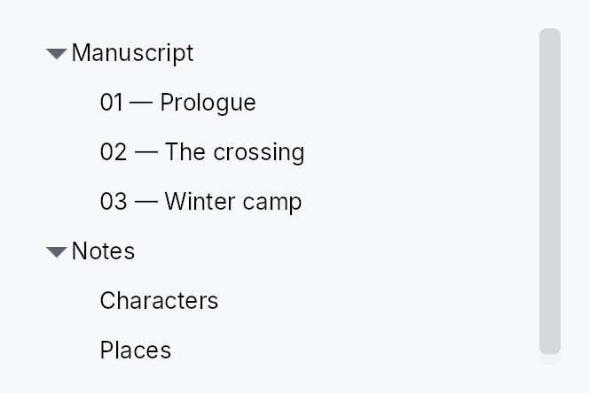
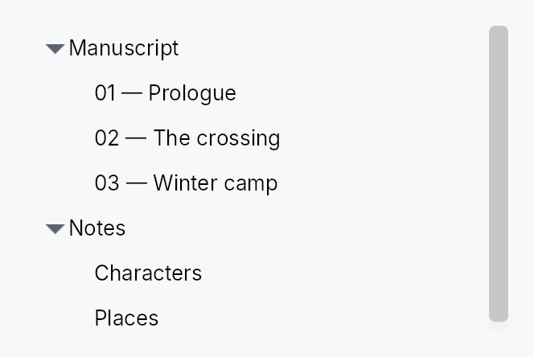

<!-- SPDX-License-Identifier: MPL-2.0 -->
<!-- SPDX-FileCopyrightText: 2026 FernTech -->

# TreeView



TreeView — a virtualized, expandable/collapsible hierarchical list widget.

## Public types

| Kind | Name |
| ---: | :--- |
| `struct` | [`TreeRowContext`](#treerowcontext) — Per-row context passed to a 4-arg TreeView delegate |
| `struct` | [`TreeView`](#treeview) |
| `struct` | [`TreeViewHandle`](#treeviewhandle) — A handle on a mounted `TreeView`, to scroll it to a row from outside the widget — a view-model revealing the node a search found, say |

## Public functions

### `TreeView`

| Returns | Function |
| ---: | :--- |
| | **Constructors** |
| `Self` | [`new(model: TreeModel<T>, delegate: impl Fn(&T, &FlatEntry, bool) -> Box<dyn Widget> + 'static)`](#treeview-new) |
| `Self` | [`new_with_context(model: TreeModel<T>, delegate: impl Fn(&T, &FlatEntry, bool, &TreeRowContext<'_, T>) -> Box<dyn Widget> + 'static)`](#treeview-new_with_context) |
| `Self` | [`from_source<S: TreeDataSource<Item = T>>(source: S, delegate: impl Fn(&T, &TreeRow, bool) -> Box<dyn Widget> + 'static)`](#treeview-from_source) |
| `Self` | [`from_source_keyed<S: TreeDataSource<Item = T>>(source: S, keyed: KeyedSelectionModel<S::Key>, delegate: impl Fn(&T, &TreeRow, bool) -> Box<dyn Widget> + 'static)`](#treeview-from_source_keyed) |
| | **Builder methods** |
| `Self` | [`enabled(enabled: impl Into<Prop<bool>>)`](#treeview-enabled) |
| `Self` | [`overscroll_behavior(behavior: OverscrollBehavior)`](#treeview-overscroll_behavior) |
| `Self` | [`item_height(height: f32)`](#treeview-item_height) |
| `Self` | [`smooth_scrolling(enabled: bool)`](#treeview-smooth_scrolling) |
| `Self` | [`smooth_scroll_duration(duration: Duration)`](#treeview-smooth_scroll_duration) |
| `Self` | [`scroll_signal(scroll: Signal<f32>)`](#treeview-scroll_signal) |
| `Self` | [`scroll_bar_style(style: ScrollBarMode)`](#treeview-scroll_bar_style) |
| `Self` | [`item_height_fn(f: impl Fn(usize) -> f32 + 'static)`](#treeview-item_height_fn) |
| `Self` | [`auto_item_height(estimated: f32)`](#treeview-auto_item_height) |
| `Self` | [`row_click_expands(b: bool)`](#treeview-row_click_expands) |
| `Self` | [`selection(sel: SelectionModel)`](#treeview-selection) |
| `Self` | [`keyed_selection(keyed: KeyedSelectionModel<NodeId>)`](#treeview-keyed_selection) |
| `Self` | [`reorderable(enabled: bool)`](#treeview-reorderable) |
| `Self` | [`exportable(mode: DragTransferMode)`](#treeview-exportable) |
| `Self` | [`export_external(f: impl Fn(&[T]) -> Vec<(String, Vec<u8>)> + 'static)`](#treeview-export_external) |
| `Self` | [`on_rows_transferred_out(f: impl Fn(&[usize], &mut teksilo_core::widget::EventContext) + 'static)`](#treeview-on_rows_transferred_out) |
| `Self` | [`accept_foreign_rows(accept: bool)`](#treeview-accept_foreign_rows) |
| `Self` | [`on_rows_received(f: impl Fn(Vec<T>, usize, &mut teksilo_core::widget::EventContext) + 'static)`](#treeview-on_rows_received) |
| `Self` | [`on_activate(f: impl Fn(usize, &mut teksilo_core::widget::EventContext) + 'static)`](#treeview-on_activate) |
| `Self` | [`activate_on(mode: crate::data_views::ActivateOn)`](#treeview-activate_on) |
| `Self` | [`row_tooltip_sticky(on: bool)`](#treeview-row_tooltip_sticky) |
| `Self` | [`row_tooltip(f: impl Fn(usize, &T) -> Option<teksilo_i18n::LocalizedString> + 'static)`](#treeview-row_tooltip) |
| `Self` | [`row_rich_tooltip(f: impl Fn(usize, &T) -> Option<crate::tooltip::RichTooltipSource> + 'static)`](#treeview-row_rich_tooltip) |
| `Self` | [`row_composite_tooltip(f: impl Fn(usize, &T) -> Option<Box<dyn teksilo_core::widget::Widget>> + 'static)`](#treeview-row_composite_tooltip) |
| `Self` | [`type_ahead_label(label: impl Fn(&T) -> String + 'static)`](#treeview-type_ahead_label) |
| `Self` | [`type_ahead_timeout(timeout: Duration)`](#treeview-type_ahead_timeout) |
| | **Methods** |
| `TreeViewHandle` | [`handle()`](#treeview-handle) |
|  | [`expand(node: teksilo_data::NodeId)`](#treeview-expand) |
|  | [`collapse(node: teksilo_data::NodeId)`](#treeview-collapse) |
|  | [`toggle(node: teksilo_data::NodeId)`](#treeview-toggle) |
|  | [`expand_all()`](#treeview-expand_all) |
|  | [`collapse_all()`](#treeview-collapse_all) |
| `Option<&TreeSlice<T>>` | [`tree_slice()`](#treeview-tree_slice) |

### `TreeRowContext`

| Returns | Function |
| ---: | :--- |
| | **Methods** |
| `std::rc::Rc<dyn Fn(&mut teksilo_core::widget::EventContext)>` | [`toggle_callback()`](#treerowcontext-toggle_callback) |
| `TreeSliceHandle<T>` | [`slice_handle()`](#treerowcontext-slice_handle) |
| `teksilo_data::NodeId` | [`node_id()`](#treerowcontext-node_id) |

### `TreeViewHandle`

| Returns | Function |
| ---: | :--- |
| | **Methods** |
|  | [`scroll_to_index(index: usize)`](#treeviewhandle-scroll_to_index) |
|  | [`ensure_index_visible(index: usize)`](#treeviewhandle-ensure_index_visible) |
| `Option<usize>` | [`cursor()`](#treeviewhandle-cursor) |
|  | [`set_cursor(index: Option<usize>)`](#treeviewhandle-set_cursor) |
| `Signal<Option<usize>>` | [`cursor_signal()`](#treeviewhandle-cursor_signal) |

## Detailed description

Displays a `TreeModel<T>` as an indented tree.
Internally each view owns a `TreeSlice` for independent
expand state, so two `TreeView`s on the same model can be open at different
depths simultaneously. Only rows in the visible viewport + a small buffer have
live widgets — rows outside the buffer are dormant, matching `ListView`'s
virtualization model. An external `TreeDataSource`
is also accepted via `TreeView::from_source` when the data lives outside a
`TreeModel`.

Row heights come in three modes: uniform (`item_height`, default fast path),
exact per-flat-index callback (`item_height_fn`), and auto-measured
(`auto_item_height` — height-for-width per row, scroll-anchored).

#### Scrolling to a row

`handle` returns a `TreeViewHandle`, a cheap `Clone`
taken before the view is added and usable from any handler afterwards. Its
`scroll_to_index` and
`ensure_index_visible` take a flat
visible row index and are applied at the next layout pass, after row
measurement and scroll anchoring, so they may follow an expansion in the
same turn, or be called before mount:

```rust
# use teksilo_widgets::TreeView;
# use teksilo_widgets::primitives::TextWidget;
# use teksilo_data::TreeModel;
# use teksilo_i18n::lit;
# let model: TreeModel<String> = TreeModel::new();
let tree = TreeView::new(model, |item, _entry, _selected| {
    Box::new(TextWidget::new(lit!(item)))
});
let handle = tree.handle();
// … `ctx.add(tree)`; then, from a handler, after expanding the row's
// ancestors in the same turn:
handle.ensure_index_visible(42);
```

#### The keyboard cursor

The tree has one current row, its keyboard cursor: the row the arrow keys
step from and the one it names to assistive technology as its active
descendant while it holds keyboard focus. The same `TreeViewHandle`
reads and moves it, in flat visible indices:
`cursor`,
`set_cursor` (clamped to the last visible
row; keyboard focus, the selection and the scroll offset are left alone)
and `cursor_signal`, for an application
to observe. The cursor follows its row through an expansion or a collapse
above it, whoever set it. A cursor set before mount is there at the first
build.

In a single selection the cursor follows the selection. In a multiple
selection the two are **separate**: `Ctrl+↓` moves the cursor and leaves
the selection, and a selection written from outside leaves the cursor
where it was. Read the cursor, not the first selected row, for "the row
the user is on".

#### Pan to scroll

The view installs `common::scrollable::ScrollableBehavior`,
which gives it the shared wheel arithmetic, a finger's pan and the
`PanClaim` that puts it on a pan's claimant chain. A pan scrolls it, the
release coasts, and a pan it cannot absorb hands the **whole** event to the
container outside. Vertical only: this view owns no horizontal offset, so a
horizontal pan is declined and chains outward. A pan that starts on a row
scrolls rather than activating it, toggling its chevron, or collapsing a
multi-selection onto it — the three things a *release* on that row commits.
Activation is a gesture, so the arbitration cancels it; the chevron and the
deferred collapse are raw `PointerUp` arms the arbitration cannot reach, so
each asks `data_views::release_completes_the_press` whether the release still
belongs to the row.

#### Keyboard

Arrows move the cursor; `Home` / `End` reach the first and last **visible**
row and `PageUp` / `PageDown` a viewport of them, each moving the selection
unless the accelerator is held, which moves the cursor alone — in a
multiple selection only: a single selection always moves with the cursor,
a selection the application sets moves the cursor onto it, and a
structural change carries the selection along with its row. `Shift`
extends a range from the anchor and `Ctrl+Shift` extends it additively.

`→` opens a closed node and, on one already open, moves into its first
child; `←` closes an open node and, on a leaf or a closed one, ascends to
the parent. Both mirror under RTL. `*` expands the whole subtree, `+` and
`-` one level. `Space` selects or toggles, `Enter` activates, `Ctrl+A` and
`Ctrl+Shift+A` select and deselect everything, and `Ctrl+Arrow` with
`Ctrl+Space` build a disjoint selection. On macOS `⌘↓` opens a row, `⌘↑`
ascends, and `⌥→`/`⌥←` expand or collapse a subtree.

The full table, and why some of it is platform-specific, is in
[docs/data-view-keyboard.md](https://github.com/ferntech-eu/teksilo/blob/main/docs/data-view-keyboard.md).

#### Example

```rust
# use teksilo_widgets::TreeView;
# use teksilo_widgets::primitives::{HStack, Padding, TextWidget};
# use teksilo_data::TreeModel;
# use teksilo_i18n::lit;
# struct Item { title: String }
# let tree_model: TreeModel<Item> = TreeModel::new();
let _w = TreeView::new(tree_model, |item, entry, _selected| {
    let indent = entry.depth as f32 * 20.0;
    Box::new(HStack::new()
        .child(Padding::new(0.0, 0.0, 0.0, indent))
        .child(TextWidget::new(lit!(&item.title))))
})
.item_height(28.0);
```

## Density

The picture above is the widget at `TargetDensity::Compact`, the mouse-and-keyboard ladder. Below is the same subject on the same canvas with only the ladder changed, so what moves is the density and nothing else — where the subject no longer fits, that is what the denser targets cost it at that size. See `docs/density-and-targets.md`.

**Touch**



## API reference

📖 [Full rustdoc API for this module](https://docs.rs/teksilo-widgets/latest/teksilo_widgets/tree_view/index.html)

<a id="treerowcontext"></a>

## `pub struct TreeRowContext`

**Import:** `use teksilo::widgets::TreeRowContext;`

Per-row context passed to a 4-arg TreeView delegate. Carries a
reference to the slice handle and the row's `NodeId` so the
delegate can wire chevron toggles and other tree-aware behavior
without manually cloning state outside the closure.

Created internally by `TreeView::new_with_context`. Not
constructed directly by user code.

```rust
pub struct TreeRowContext<'a, T: 'static> { /* fields */ }
```

### Methods

<a id="treerowcontext-toggle_callback"></a>

#### `pub fn toggle_callback(&self) -> std::rc::Rc<dyn Fn(&mut teksilo_core::widget::EventContext)>`

Toggle callback for this row's chevron. Wires in one line:
`.on_chevron_toggle_rc(ctx.toggle_callback())`.

<a id="treerowcontext-slice_handle"></a>

#### `pub fn slice_handle(&self) -> TreeSliceHandle<T>`

Cloned handle to the slice — call `.toggle_expand(node)`,
`.expand(node)`, `.collapse(node)` directly.

<a id="treerowcontext-node_id"></a>

#### `pub fn node_id(&self) -> teksilo_data::NodeId`

The `NodeId` of this row in the backing `TreeModel`.

<a id="treeview"></a>

## `pub struct TreeView`

**Import:** `use teksilo::widgets::TreeView;`

```rust
pub struct TreeView<T: 'static> { /* fields */ }
```

### Methods

<a id="treeview-handle"></a>

#### `pub fn handle(&self) -> TreeViewHandle`

A handle that scrolls this tree once it is mounted.

Take it while describing the tree, before the view is handed to
`ctx.add(...)`; it stays attached to the view across rebuilds. See
`TreeViewHandle`.

<a id="treeview-new"></a>

#### `pub fn new( model: TreeModel<T>, delegate: impl Fn(&T, &FlatEntry, bool) -> Box<dyn Widget> + 'static, ) -> Self`

Create a new TreeView backed by a `TreeModel<T>`.

The delegate receives `(&item, &FlatEntry, selected)` and returns a
boxed widget. The `FlatEntry` provides `depth`, `has_children`, and
`is_expanded` for rendering indentation and expand/collapse toggles.

<a id="treeview-new_with_context"></a>

#### `pub fn new_with_context( model: TreeModel<T>, delegate: impl Fn(&T, &FlatEntry, bool, &TreeRowContext<'_, T>) -> Box<dyn Widget> + 'static, ) -> Self`

Like `new`, but the delegate also receives a
`TreeRowContext` from which `.toggle_callback()` can be
pulled in a single line — eliminating the need to manually
clone the slice handle outside the closure.

```rust
# use teksilo_widgets::{TreeView, StandardTreeItem};
# use teksilo_data::TreeModel;
# use teksilo_i18n::lit;
# struct Item { title: String }
# let model: TreeModel<Item> = TreeModel::new();
let _w = TreeView::new_with_context(model, |item, entry, selected, ctx| {
    Box::new(
        StandardTreeItem::new(lit!(&item.title))
            .from_entry(entry)
            .selected(selected)
            .on_chevron_toggle_rc(ctx.toggle_callback())
    )
});
```

<a id="treeview-from_source"></a>

#### `pub fn from_source<S: TreeDataSource<Item = T>>( source: S, delegate: impl Fn(&T, &TreeRow, bool) -> Box<dyn Widget> + 'static, ) -> Self`

Create a TreeView backed by any `TreeDataSource` — an external source of
truth (e.g. an entity store) carrying its own `Key`, so it needs no
`TreeModel` mirror. The delegate receives `(&item, &TreeRow, selected)`;
`TreeRow` exposes `depth` / `has_children` / `is_expanded` and a one-call
chevron `toggle_callback()`. Drop validation + lazy windowing route
through the source's `can_accept` / `accept_drop` / `row_state`.

<a id="treeview-from_source_keyed"></a>

#### `pub fn from_source_keyed<S: TreeDataSource<Item = T>>( source: S, keyed: KeyedSelectionModel<S::Key>, delegate: impl Fn(&T, &TreeRow, bool) -> Box<dyn Widget> + 'static, ) -> Self where S::Key: ItemKey,`

Like `from_source` but with **keyed** selection: the
`KeyedSelectionModel<S::Key>` tracks selection by source identity, so it
survives expand / collapse / filter / reorder and stays consistent across
two views of the same source. The view stays `TreeView<T>` — the `Key` is
captured here. Pruning consults the source's
`contains_key`, so a
collapsed-but-present node keeps its selection.

<a id="treeview-enabled"></a>

#### `pub fn enabled(mut self, enabled: impl Into<Prop<bool>>) -> Self`

Enable or disable the whole view. A disabled view greys out and stops
accepting focus / selection / keyboard input (arena-gated).

<a id="treeview-overscroll_behavior"></a>

#### `pub fn overscroll_behavior(mut self, behavior: OverscrollBehavior) -> Self`

Set the scroll-chaining behavior at the boundary (default
`OverscrollBehavior::Chain`; `Contain`
disables chaining to an ancestor scrollable).

<a id="treeview-item_height"></a>

#### `pub fn item_height(mut self, height: f32) -> Self`

Set the fixed height per row (default 28.0) — the uniform fast
path. Mutually exclusive with `item_height_fn`
and `auto_item_height`; the last mode
setter wins.

<a id="treeview-smooth_scrolling"></a>

#### `pub fn smooth_scrolling(mut self, enabled: bool) -> Self`

Enable or disable animated wheel scrolling (enabled by default).
When disabled, wheel events snap immediately to the new offset.

<a id="treeview-smooth_scroll_duration"></a>

#### `pub fn smooth_scroll_duration(mut self, duration: Duration) -> Self`

Duration of the smooth scroll animation (default 150 ms).

<a id="treeview-scroll_signal"></a>

#### `pub fn scroll_signal(mut self, scroll: Signal<f32>) -> Self`

**Scroll from a signal the caller owns**, so the position survives the
view.

A `TreeView` mints its own by default, which is right for a tree whose
lifetime is the writer's: it is created once and scrolls until they leave.
It is wrong for one inside a dock, whose content is torn down and rebuilt
whenever the layout changes -- opening a panel beside it, or the first
reveal of the band a result previews into. The tree comes back at the top,
and the row the writer was reading is somewhere above it.

Hold the signal wherever the *model* lives and the position outlives the
widget, as the expand set already does.

⚠ Pass an **animated** signal (`Signal::new_animated`) unless smooth
scrolling is off: the view animates this one, and a plain signal makes
every wheel notch a jump.

<a id="treeview-scroll_bar_style"></a>

#### `pub fn scroll_bar_style(mut self, style: ScrollBarMode) -> Self`

How the scroll bar is displayed (default `Permanent`). `Overlay`
and `Thin` float the bar over the content instead of reserving a
layout column for it, mirroring `ScrollArea::scroll_bar_style`.

<a id="treeview-item_height_fn"></a>

#### `pub fn item_height_fn(mut self, f: impl Fn(usize) -> f32 + 'static) -> Self`

Per-row heights from a callback over the *flat (visible) index*.
The callback must be pure (same index + same data → same height);
it is re-swept from the first changed flat index on every model
change or expand/collapse. No measurement pass runs.

<a id="treeview-auto_item_height"></a>

#### `pub fn auto_item_height(mut self, estimated: f32) -> Self`

Auto-measured row heights: each realized row is measured at the
tree's content width (height-for-width), unrealized rows assume
`estimated`. Scroll anchoring keeps content above the viewport
stationary as estimates are corrected; measured heights above a
toggled row survive expand/collapse (divergence-driven
invalidation).

<a id="treeview-row_click_expands"></a>

#### `pub fn row_click_expands(mut self, b: bool) -> Self`

Whether a row-body PointerUp on a branch row auto-toggles its
expansion (default `true`). Set to `false` when the delegate
provides its own chevron tap target (e.g. `StandardTreeItem`)
— without this, the auto-toggle fires in addition to the
chevron's own click and they cancel out, leaving the row
expanded only on body clicks.

<a id="treeview-selection"></a>

#### `pub fn selection(mut self, sel: SelectionModel) -> Self`

Set the index-based selection model (visible positions). Unlike
`ListView` (where every structural change carries an insert/remove
`DataChange` the selection index-shifts against), a `TreeView`'s
structural changes — including expand/collapse — surface only as a
version bump, with no delta to shift a *selected index* by. The
keyboard cursor tracks its row by identity (a `RowAnchor`), and in a
**single** selection the view keeps the cursor on the selected row, so
the selection follows that row to its new position. In a **multiple**
selection a moved row's old index is only clamped into range, not
followed. A selected row that disappears — removed, or hidden by a
collapse — leaves the selection at its clamped position in either mode.
For selection that survives all of these, use
`keyed_selection` instead.

<a id="treeview-keyed_selection"></a>

#### `pub fn keyed_selection(mut self, keyed: KeyedSelectionModel<NodeId>) -> Self`

Set a keyed selection model (by `NodeId`). Selection is tracked by node
identity, so it survives expand / collapse, filtering, and node moves —
and stays consistent if two views share the model. Pruned of deleted
nodes on each slice change. Mutually exclusive with
`selection` (last one set wins).

<a id="treeview-reorderable"></a>

#### `pub fn reorderable(mut self, enabled: bool) -> Self`

Enable intra-widget drag reordering.

When enabled, tree rows can be dragged to reparent or reorder them.
Before/Into/After is chosen by where in the row the pointer drops; the
move is cycle-guarded — a drop onto the node itself or into its own
subtree is refused and shows no insertion line. Keyboard equivalent:
Alt+ArrowUp/Down.

<a id="treeview-exportable"></a>

#### `pub fn exportable(mut self, mode: DragTransferMode) -> Self where T: Clone,`

Make rows **droppable outside this view** — on a
`DropTarget`, another data view, or the OS.

A dragged row (or the whole selection, when the pressed row is part of a
multi-selection) carries clones of its items in a public
`RowDragData<T>`, so a foreign receiver can pull
them out with `payload.get_typed::<RowDragData<T>>()` /
`DropTarget::on_drop_typed::<RowDragData<T>>()` — no serialization. This
also makes rows a drag source even without `reorderable`.

`mode` chooses what happens to the origin rows once a *foreign* target
accepts them: `DragTransferMode::Move` removes them (via the source's
`on_drag_out`, or `on_rows_transferred_out`),
`DragTransferMode::Copy` leaves them. A same-view reorder is never a
transfer, so `mode` never affects it. Requires `T: Clone`.

<a id="treeview-export_external"></a>

#### `pub fn export_external(mut self, f: impl Fn(&[T]) -> Vec<(String, Vec<u8>)> + 'static) -> Self where T: Clone,`

Additionally advertise the dragged rows as MIME data so they can be
dropped on a `DropZone` or exported to another
application / window via the OS. `f` maps the dragged items to
`(mime_type, bytes)` pairs (e.g. `text/plain`, `text/uri-list`, an
app-specific `application/x-…`). Implies `exportable`
(defaulting to `DragTransferMode::Move` if not already set). Requires
`T: Clone`.

<a id="treeview-on_rows_transferred_out"></a>

#### `pub fn on_rows_transferred_out( mut self, f: impl Fn(&[usize], &mut teksilo_core::widget::EventContext) + 'static, ) -> Self`

Override how rows moved out to a foreign target are removed from this
view. Receives the dragged rows' indices (descending-safe) and the live
context. Without this, an `exportable`
`Move` drag removes them through the source's
`on_drag_out` (works out of the box for a `TreeSlice`/`TreeModel`).

<a id="treeview-accept_foreign_rows"></a>

#### `pub fn accept_foreign_rows(mut self, accept: bool) -> Self`

Accept exported rows dropped from a **different** view or source without
writing a custom `TreeDataSource`. Pair with
`on_rows_received`, which is handed the dropped
items and the insertion index. (Same-view reorder is
`reorderable`; a custom `TreeDataSource` can still
accept foreign drops through its `can_accept`/`accept_drop` instead.)

<a id="treeview-on_rows_received"></a>

#### `pub fn on_rows_received( mut self, f: impl Fn(Vec<T>, usize, &mut teksilo_core::widget::EventContext) + 'static, ) -> Self`

Handler for rows accepted via `accept_foreign_rows`:
`(items, insertion_index, ctx)`. Insert them into your model at the
index.

<a id="treeview-on_activate"></a>

#### `pub fn on_activate( mut self, f: impl Fn(usize, &mut teksilo_core::widget::EventContext) + 'static, ) -> Self`

Set the row-**activation** handler — invoked with the flat row index on a
primary click on the row body (per `activate_on`,
which defaults to a double click), or **Enter** on the focused row.
Activation is distinct from *selection*: arrow-key navigation and
**Space** move / toggle the selection but do **not** activate, so a view
can open/commit a row on a deliberate click/Enter without firing on
every navigation step.

<a id="treeview-activate_on"></a>

#### `pub fn activate_on(mut self, mode: crate::data_views::ActivateOn) -> Self`

Choose single- vs double-click activation (default
`ActivateOn::DoubleClick` — the cross-platform
convention; pass `SingleClick` for the
KDE/web/Scrivener feel). Enter activates in either mode.

<a id="treeview-row_tooltip_sticky"></a>

#### `pub fn row_tooltip_sticky(mut self, on: bool) -> Self`

Whether a composite row tooltip offers dwell-to-sticky promotion.
Default `true`.

Turn it off for a read-only row card: with nothing to reach into there
is nothing to pin, so the countdown indicator would promise an
interaction that does not exist and the surface would outlive the
pointer for no reason.

<a id="treeview-row_tooltip"></a>

#### `pub fn row_tooltip( mut self, f: impl Fn(usize, &T) -> Option<teksilo_i18n::LocalizedString> + 'static, ) -> Self`

Per-row plain tooltip: one line of text for the row under the pointer.

The resolver receives the row's flat index and its item; returning
`None` leaves that row without a tip. Mutually exclusive with
`row_rich_tooltip` and
`row_composite_tooltip` — last setter
wins, matching the per-widget tooltip matrix.

Opens to the row's trailing side, never below it: rows stack
vertically, so a tip below would cover the next row.

<a id="treeview-row_rich_tooltip"></a>

#### `pub fn row_rich_tooltip( mut self, f: impl Fn(usize, &T) -> Option<crate::tooltip::RichTooltipSource> + 'static, ) -> Self`

Per-row rich tooltip — a registry key or inline
`TooltipContent`, both of which
convert into `RichTooltipSource`.
See `row_tooltip` for the shared semantics.

<a id="treeview-row_composite_tooltip"></a>

#### `pub fn row_composite_tooltip( mut self, f: impl Fn(usize, &T) -> Option<Box<dyn teksilo_core::widget::Widget>> + 'static, ) -> Self`

Per-row composite tooltip — an arbitrary widget tree describing the row.

The body is built for every **realized** row (the virtualization window)
and rebuilt with it, so keep the resolver cheap and defer anything
costly to the body's own first paint, which only runs if the tip is
actually shown. See `row_tooltip` for the rest.

<a id="treeview-type_ahead_label"></a>

#### `pub fn type_ahead_label(mut self, label: impl Fn(&T) -> String + 'static) -> Self`

Enable **type-ahead** ("type to jump"): typing a printable character
while the tree has keyboard focus jumps the selection to the next
*visible* row whose label starts with the accumulated search term,
wrapping around (Qt `keyboardSearch` / macOS & Windows type-select).
`label(&item)` yields the searchable text; matching is
ASCII-case-insensitive. A pause longer than the
`type_ahead_timeout` starts a fresh term.

<a id="treeview-type_ahead_timeout"></a>

#### `pub fn type_ahead_timeout(mut self, timeout: Duration) -> Self`

Reset window between keystrokes before the type-ahead search term
clears (default 500 ms). A zero duration disables type-ahead.

<a id="treeview-expand"></a>

#### `pub fn expand(&self, node: teksilo_data::NodeId)`

Expand a node programmatically. No-op on the `from_source` path (which
owns its own expand state — use the source's `set_expanded`).

<a id="treeview-collapse"></a>

#### `pub fn collapse(&self, node: teksilo_data::NodeId)`

Collapse a node programmatically. No-op on the `from_source` path.

<a id="treeview-toggle"></a>

#### `pub fn toggle(&self, node: teksilo_data::NodeId)`

Toggle a node's expand/collapse state. No-op on the `from_source` path.

<a id="treeview-expand_all"></a>

#### `pub fn expand_all(&self)`

Expand all nodes. No-op on the `from_source` path.

<a id="treeview-collapse_all"></a>

#### `pub fn collapse_all(&self)`

Collapse all nodes. No-op on the `from_source` path.

<a id="treeview-tree_slice"></a>

#### `pub fn tree_slice(&self) -> Option<&TreeSlice<T>>`

Access the internal `TreeSlice` (for persistence of expand state).
`None` on the `from_source` path, which has no
`TreeSlice` (the external source owns expand state).

<a id="treeviewhandle"></a>

## `pub struct TreeViewHandle`

**Import:** `use teksilo::widgets::TreeViewHandle;`

A handle on a mounted `TreeView`, to scroll it to a row from outside the
widget — a view-model revealing the node a search found, say.

Rows are addressed by their **flat visible index**: the position of the row
among the rows currently shown, counting the children of expanded nodes and
skipping those of collapsed ones (the index the delegate's selection and the
keyboard use).

Cheap to clone, valid before the view is mounted, and it survives the
view's rebuilds. Its methods never compute an offset when they are called:
they record the request and ask for a layout pass, and the view applies it
there, after row measurement and scroll anchoring have settled. So a
structural change made in the same turn (a node expanded above the target,
say) is accounted for, a request made before mount is applied at the first
layout, and a later request replaces an earlier pending one. A request on
an empty tree is dropped; an index past the end reveals the last row.

The handle also reads and moves the tree's **keyboard cursor**, the row the
arrow keys step from and assistive technology is told is current:
`cursor`, `set_cursor` and
`cursor_signal`, in the same flat visible indices.
In a multiple selection the cursor and the selection are separate: the
accelerator with an arrow moves the cursor alone, and a selection written
from outside leaves the cursor where it was.

```rust
# use teksilo_widgets::TreeView;
# use teksilo_widgets::primitives::TextWidget;
# use teksilo_data::TreeModel;
# use teksilo_i18n::lit;
# let model: TreeModel<String> = TreeModel::new();
let tree = TreeView::new(model, |item, _entry, _selected| {
    Box::new(TextWidget::new(lit!(item)))
});
let handle = tree.handle();
// … `ctx.add(tree)`; later, after expanding the node's ancestors:
handle.ensure_index_visible(42);
```

```rust
pub struct TreeViewHandle { /* fields */ }
```

### Methods

<a id="treeviewhandle-scroll_to_index"></a>

#### `pub fn scroll_to_index(&self, index: usize)`

Scroll so the row at the given flat visible index is aligned to the
top of the viewport, as far as the scroll range allows, at the next
layout pass.

<a id="treeviewhandle-ensure_index_visible"></a>

#### `pub fn ensure_index_visible(&self, index: usize)`

Scroll the minimum distance that brings the row at the given flat
visible index fully into view, at the next layout pass; no scroll
when it already is.

<a id="treeviewhandle-cursor"></a>

#### `pub fn cursor(&self) -> Option<usize>`

The flat visible index the keyboard cursor is on, or `None` while the
tree has no cursor: it has not been navigated, clicked or given one by
`set_cursor`. With no cursor the keys start from
the first selected row, and from the first or last row when nothing is
selected.

The cursor follows its row: an expansion or a collapse above it, or an
insertion, moves the index with the row, and a row that leaves the
visible rows takes the cursor with it. In a single selection
the cursor follows the selection: the keys move them together, and a
selection written from outside moves the cursor onto it. In a multiple
selection they are separate: the accelerator with an arrow
(`Ctrl+Arrow`) moves the cursor alone, and a selection written from
outside leaves the cursor where it was.

<a id="treeviewhandle-set_cursor"></a>

#### `pub fn set_cursor(&self, index: Option<usize>)`

Move the keyboard cursor to the row at flat visible index `index`, or
remove it with `None`.

An index past the last visible row is clamped to that row; on an empty
tree the cursor is removed. While the tree holds keyboard focus it
names the row as its active descendant at the next accessibility
update, when the row is realized; the next arrow key steps from it,
and the cursor follows that row through later structural changes.

Keyboard focus and the selection are left alone, and the tree does not
scroll: pair it with
`ensure_index_visible` to bring the row
into view. Usable before the tree is mounted and across its rebuilds;
in a single selection the tree seats the cursor on the selected row
when it is built and whenever the selection changes.

<a id="treeviewhandle-cursor_signal"></a>

#### `pub fn cursor_signal(&self) -> Signal<Option<usize>>`

A read-only signal of the cursor, as `cursor` reports
it, for an application to observe or bind: a status line naming the
current row, actions enabled for it. It changes with every write of
the cursor, by the keys, a click, a structural change moving it or
`set_cursor`.
